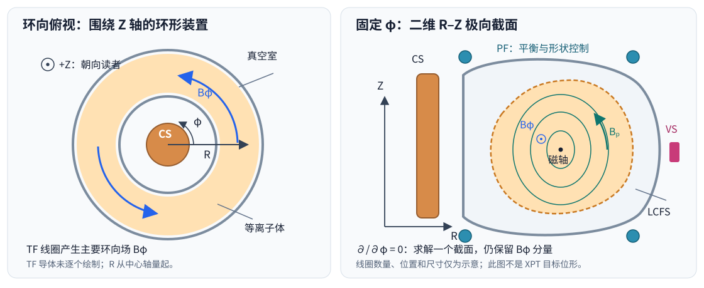
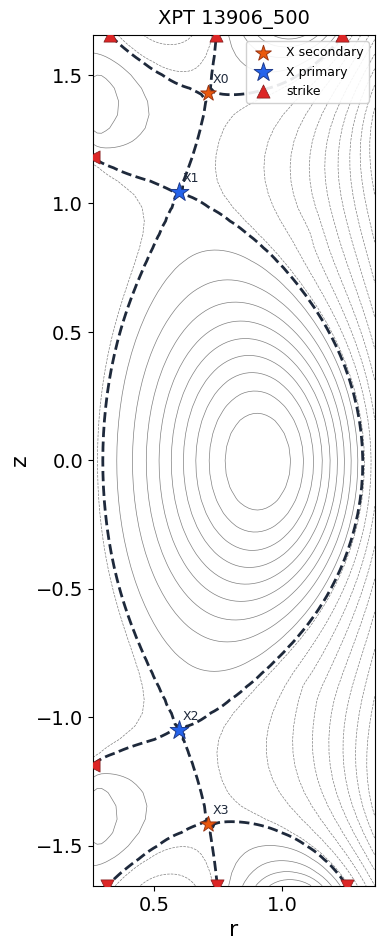
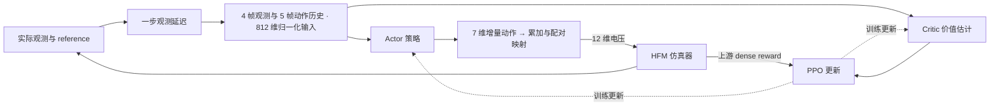

# 1. 项目背景

本项目需要在托卡马克仿真环境中训练神经网络控制器，从**限制器**初始平衡位形出发，在 **500 ms** 内控制等离子体演化为 **XPT** 位形，同时控制等离子体的**电流、位置和边界形状**。

## 1.1 装置结构与线圈

托卡马克用磁场约束环形真空室中的等离子体。等离子体电流与外部线圈共同产生磁场，形成包围等离子体的磁面；控制线圈电压可以改变电流、平衡位置和形状。

| 名称                         | 含义与作用                              | 本项目控制接口      |
| -------------------------- | ---------------------------------- | ------------ |
| TF（Toroidal Field）         | 环向场线圈，产生沿环形装置方向的主要磁场，参与磁约束         | 背景磁场，不在策略动作中 |
| CS（Central Solenoid）       | 中央螺线管，位于装置中心，通过变化的磁通感应环电压，驱动等离子体电流 | 第 1 个电压通道    |
| PF1–PF10（Poloidal Field）   | 极向场线圈，参与控制等离子体位置、形状和磁拓扑            | 第 2–11 个电压通道 |
| VS（Vertical Stabilization） | 垂直稳定线圈，用于快速抑制垂直位移                  | 第 12 个电压通道   |

上述作用相互耦合。本项目将 10 个 PF 通道两两配对，因此策略输出 **7 维动作**（CS、5 组 PF、VS），再映射为 **12 维线圈电压**。



图 1：左侧为环向俯视，右侧为极向截面。线圈位置、数量和尺寸仅作示意；右侧闭合磁面不是本任务的 XPT 目标位形。

## 1.2 柱坐标与二维简化

采用柱坐标 $(R,\phi,Z)$ ： $R$ 是到装置中心轴的距离， $\phi$ 是绕中心轴的环向角， $Z$ 是竖直坐标。在轴对称近似下，各物理量满足 $\partial/\partial\phi=0$ ，因此只需求解一个固定 $\phi$ 的 $R$ – $Z$ 极向截面。这是空间对称性带来的简化，环向磁场 $B_\phi$ 仍然存在。

**LCFS** 是最外层闭合磁面，其截线表示等离子体边界。限制器位形的边界由限制器接触确定；偏滤器位形则具有极向磁场为零的 **X 点**（磁通鞍点）。本项目的 XPT 目标包含主、次级两对 X 点，并使用 8 个打击点描述边界几何。

<p align="center">
  
</p>

图 2：参考资料中的 XPT 磁通截面。蓝色、橙色星号分别标出主、次级 X 点，红色三角标出打击点。图中的矩形边界是计算域边界；本项目打击点是磁通轮廓与该边界相交的几何代理，不等同于真实偏滤器靶板上的热流沉积点。

# 2. 评估指标与评分计算

评测将仿真实际轨迹与官方 `target.json` 中的目标几何比较。总时长为 500 ms，共 $N=500$ 步，每步 1 ms，满分 **30 分**。电流目标由评分代码规定：前 100 ms 从 500 kA 线性下降至 400 kA，此后保持 400 kA；第 $k$ 个评分步对应 $t_k=k$ ms，首步目标为 499 kA。

## 2.1 七项指标

| 指标 | 逐步误差 $\epsilon_i$ | 零分阈值 $\epsilon_i^{\max}$ | 权重／最高贡献分 $w_i$ |
| --- | --- | --- | --- |
| Ip | 等离子体电流相对误差 $\lvert I_p-I_p^{\rm ref}\rvert/\lvert I_p^{\rm ref}\rvert$ | 0.05（5%） | 6 |
| LCFS | 32 个对应边界点的位置 RMS 偏差 | 3 cm | 6 |
| X | 2 个主 X 点的位置 RMS 偏差 | 3 cm | 4 |
| strike | 8 个打击点的位置 RMS 偏差 | 10 cm | 3 |
| psiX | 主 X 点相对实际边界磁通的归一化 RMS 偏差 | 0.003 | 4 |
| X2 | 2 个次级 X 点的位置 RMS 偏差 | 5 cm | 3 |
| psiX2 | 次级 X 点相对实际边界磁通的归一化 RMS 偏差 | 0.005 | 4 |

位置误差统一按下式计算，坐标单位为 m，误差单位为 cm：

```math
\epsilon_{\rm pos}=100\sqrt{\frac{1}{M}\sum_{j=1}^{M}\left[(R_j-R_j^{\rm ref})^2+(Z_j-Z_j^{\rm ref})^2\right]}.
```

$M$ 是该指标的点数， $j$ 是匹配后的点序号，上标 $\rm ref$ 表示目标。LCFS 按对应采样点比较，不先平移对齐等离子体中心。

磁通指标使用实际观测中的 X 点、边界和磁轴磁通：

```math
\epsilon_{\psi X}=\sqrt{\frac{1}{2}\sum_{j=1}^{2}\left(\frac{F_{X,j}-F_B}{F_B-F_A}\right)^2}.
```

$F_{X,j}$ 为主 X 点磁通， $F_B$ 为实际边界磁通， $F_A$ 为实际磁轴磁通。`psiX2` 将 $F_{X,j}$ 换成次级 X 点磁通，计算方式相同。

## 2.2 总分计算

每项误差先映射为 $[0,1]$ 内的单步分数：

```math
s_i(k)=\max\left(0,1-\frac{\epsilon_i(k)}{\epsilon_i^{\max}}\right).
```

再计算加权、约束修正后的 500 步平均分：

```math
S=\frac{\Gamma}{500}\sum_{k=1}^{K}\eta_k\mu_k\rho_k
\left[6s_{Ip}(k)+6s_{LCFS}(k)+\tau_k\left(4s_X(k)+3s_{strike}(k)+4s_{psiX}(k)+3s_{X2}(k)+4s_{psiX2}(k)\right)\right].
```

其中 $K\leq500$ 为有效仿真步数；提前终止后的剩余步按零分计，分母仍为 500。约束系数为：

| 系数 | 当前评分规则 |
| --- | --- |
| $\eta_k$ ：位形系数 | `lX == 1` 时为 1，否则为 0.5 |
| $\mu_k$ ：电流偏差 | 当步电流绝对偏差超过 50 kA 时为 0，否则为 1；后续满足约束可恢复 |
| $\rho_k$ ：线圈电流 | 任一线圈首次越限后，当步及后续均为 0；CS、PF、VS 限值分别为 45、14、4 kA |
| $\tau_k$ ：XPT 拓扑 | X 点数 `nX` 四舍五入后等于 4 时为 1，否则为 0，只作用于五项 XPT 指标 |
| $\Gamma$ ：整段惩罚 | 仿真超时则总分为 0；提供推理耗时时，超过 0.5 ms 的步数多于 50 步也置零，否则为 1；未提供耗时不触发该耗时惩罚 |

榜单中的七项贡献分已经包含权重、时间平均及惩罚，直接相加即为综合分，不再重复加权。

第 8 节的远程正式测评由 C 记录 文件交换往返耗时作为审计信息，不将其作为模型内核推理耗时，因此不触发上述 0.5 ms 耗时惩罚；C 另有通信超时和整场评测超时限制。

# 3. 仿真器与控制架构

HFM 是一个将轴对称自由边界等离子体平衡与线圈／被动导体回路耦合、按时间步推进的托卡马克控制仿真器。

## 3.1 求解的主要方程

**磁平衡：Grad–Shafranov 方程。** 在等离子体区域内，参考模型使用总极向磁通 $F$ 的约定：

```math
\begin{aligned}
\Delta^{\ast}F+4\pi^2\left(\mu_0R^2\frac{dP}{dF}+T\frac{dT}{dF}\right)&=0,\\
\Delta^{\ast}&=R\frac{\partial}{\partial R}\left(\frac{1}{R}\frac{\partial}{\partial R}\right)+\frac{\partial^2}{\partial Z^2}.
\end{aligned}
```

$F$ 为总极向磁通（Wb）， $P(F)$ 为压强， $T(F)=RB_\phi$ 为环向场函数（不是温度）， $\mu_0$ 为真空磁导率。 $\Delta^{\ast}F$ 描述磁通空间变化，括号内两项分别表示压强梯度和环向场函数对平衡的贡献。自由边界由等离子体电流和外部导体电流共同决定。

极向磁场由磁通导数得到：

```math
B_R=-\frac{1}{2\pi R}\frac{\partial F}{\partial Z},
\qquad B_Z=\frac{1}{2\pi R}\frac{\partial F}{\partial R}.
```

$B_R$ 、 $B_Z$ 分别是径向和竖直磁场； $2\pi$ 来自总磁通 $F$ 的定义。若改用每弧度磁通 $\psi=F/(2\pi)$ ，方程系数也要相应改变。

**导体回路：电压驱动电流演化。** 其连续形式为：

```math
M_{ee}\dot{\boldsymbol i}_e+M_{ey}\dot{\boldsymbol i}_y+D_R\boldsymbol i_e=\boldsymbol v_e.
```

$\boldsymbol i_e$ 是主动线圈与被动导体的电流向量， $\boldsymbol i_y$ 是等离子体网格电流向量； $M_{ee}$ 为导体自感／互感矩阵， $M_{ey}$ 为导体与等离子体的互感矩阵， $D_R$ 为导体电阻对角矩阵， $\boldsymbol v_e$ 为外加电压向量（被动导体分量为零），上点表示时间导数。左侧依次是导体感应电压、等离子体耦合电压和电阻压降。

**等离子体总电流闭合：** 默认零维模型可写为：

```math
L_p\dot I_p+R_p(I_p-I_{\rm ni})+\boldsymbol w^{\mathsf{T}}M_{ye}\dot{\boldsymbol i}_e=0,
\qquad I_p=\sum_j i_{y,j},\quad \boldsymbol w=\boldsymbol i_y/I_p.
```

$L_p$ 、 $R_p$ 是等离子体等效电感、电阻， $I_{\rm ni}$ 为非感应驱动电流； $\boldsymbol w$ 为归一化网格电流权重， $M_{ye}$ 描述导体对等离子体的磁耦合， $\mathsf T$ 表示转置。三项分别为感应电压、电阻压降和外部导体耦合电压。求解器通过隐式时间离散联立更新回路电流与自由边界平衡，并非求解完整三维 MHD 演化。

## 3.2 Actor–Critic 控制

本项目 baseline 用 **PPO** 训练 Actor–Critic 网络：Actor 根据实际状态、目标误差和历史信息输出控制动作；Critic 基于相同的 **812 维输入**估计后续回报，帮助 PPO 计算优势并更新策略。两者各使用两层 256 单元的 Tanh 网络；部署推理时使用 Actor。



默认 `historical_observation_v1` 接口使用 `ObservationWrapper`，恢复自 SII-585-THU 的 F2 实现，来源 commit 为 `ffda09ab4621ede477ff71247547f8cbc43d133a`。每帧 **188 维观测**按以下顺序编码，拼接 **4 帧观测 + 5 帧 12 维物理动作 = 812 维**。选手可修改特征和 wrapper；远程提交时在 A 复用自己的训练接口，见第 8.4 节。

| 字段 | 维度 |
| --- | ---: |
| 实际 `Ip`、`Ip-reference_Ip`、`reference_Ip` | 3 |
| 实际拓扑 `lX`、`lX-reference_lX` | 2 |
| 实际 LCFS 的 32 个二维点 | 64 |
| LCFS 实际点与目标点的坐标误差 | 64 |
| 12 路线圈电流除以各自限值、最大电流占限值比例 `coil_margin` | 13 |
| 4 个 X 点槽位的有效标志、径向误差、竖直误差、归一磁通误差 | 16 |
| X 点数量、实际打击点数量 | 2 |
| 8 个打击点槽位的有效标志、径向误差、竖直误差 | 24 |
| **单帧合计** | **188** |

X 点与打击点先匹配到目标槽位，无效槽位的误差置零。每回合 reset 清空历史，以零填充较早观测和动作；第一步执行后，5 个动作槽位均填入首个物理动作，之后逐步滚动。训练默认 `features.history_steps=4`、`features.delay_step=1`；一步延迟按上游逻辑作用于整个观测字典，包含 reference。原有 90 维 `reference_only_v1` 仅用于加载 metadata、模型与归一化统计匹配的已有产物，不作为新 baseline。

默认 `actions.mode=delta`：7 维归一化输出先裁剪到 `[-1,1]`，转换为电压增量并累加，再经配对映射得到 12 维物理电压。动作历史保存这 12 维电压。正式测评中的电源传输延迟、变化率限制和 PSM 由 C 执行。

训练奖励也恢复为同一上游 commit 的 `SemifinalDenseReward`，配置为 `score_lower_bound=false`、`use_competition_score=false`。训练权重依次为 Ip=6、LCFS=6、主 X 位置=4、主 X 磁通=4、次级 X 位置=4、次级 X 磁通=3、strike=3；failure 和线圈越限惩罚均为 -5。它使用平滑误差映射、soft current mask，次级 X 两项权重也与正式评分不同，因此**原始 dense reward 的整段总和不等于正式比赛分数**。第 2 节的七项指标、满分 30 分及正式评分代码保持不变；实验结果须单独通过正式评分器计算。

# 4. 准备工作

在启智平台招生营专项空间中新建交互式建模，选择**标准模式、55 核 CPU**，镜像使用 `subexl50u-new:v2`，将本项目克隆到工作目录。

以下命令均在 **Linux 的 Bash 终端、`plasma-control` 项目根目录**执行。`YOUR_RUN_NAME` 是自定的训练名称，`YOUR_RUN` 是训练生成的完整运行目录名。

复制公共目录中的仿真器压缩包并解压到项目的同级目录，然后激活环境：

```bash
cp -r ../public/inspire_shared/hfm-runtime-release-sealed-latest .
conda activate competition_env
pip install -e '.[baseline]'
```
或者
```
cp ../public/inspire_shared/hfm-runtime-release-sealed-latest.tar .
```

后续命令假设仿真器位于 `../hfm-runtime-release-sealed-latest`；若实际位置不同，请替换路径。

# 5. 训练模型

需要 32 个 HFM socket 实例，对应端口 `2223–2254`。已有空闲实例时直接复用；尚未启动时执行以下命令，每个环境连接一个独立实例：

```bash
bash ../hfm-runtime-release-sealed-latest/tasksetstart.sh \
  --num 32 --base-port 2223
```

各实例日志保存在仿真器的 `logs/hfm_<端口>.log`。等待实例输出 `Waiting for a client to connect...` 后启动训练：

```bash
python train/train_ppo.py \
  output_dir=YOUR_RUN_NAME \
  features.observation_mode=historical_observation_v1 \
  features.history_steps=4 \
  features.delay_step=1 \
  actions.mode=delta \
  reset_perturbation.fix_reset_params=false \
  num_envs=32 \
  ports=2223 
```

训练产物保存在 `results/` 下的运行目录中。增减环境数时，应同时调整实例数量和 `num_envs`，注意HFM socket实例端口（port）要能与训练连接端口对应。

每个运行目录均保存 `monitor.csv`、`logs/reward_components.csv` 和 `logs/ppo/progress.csv`，TensorBoard 事件也写入 `logs/ppo/`。本地 CSV 与 TensorBoard 始终启用。W&B 可使用 `WANDB_MODE=offline` 离线记录，无需登录；也可用 `wandb.enabled=false` 关闭。启智平台新建 TensorBoard 时，将 Summary 文件路径指向该运行目录的 `logs/ppo/`。

完整 10m 实验的统一命令及记录格式见第 9 节。

# 6. 验证模型

验证模型将使用训练好的actor在测试shot上进行完整的500ms控制，得到等离子电流（Ip）、最外层闭合磁通位置（LCFS）等观测量在500ms内的变化序列。

保持端口 `2223` 的 HFM 实例运行并处于空闲状态。将 `YOUR_RUN` 替换为训练生成的运行目录名。

训练至少保存一次 checkpoint 后，可以按 `Ctrl+C` 中断训练，再执行以下命令验证。命令从 `checkpoints/` 中选择训练步数最大的模型，通过 `eval.cp_num` 加载，同时查找对应的 `*_vecnormalize.pkl` 归一化文件：

```bash
RUN_DIR=results/YOUR_RUN

LATEST_CP=$(find "$RUN_DIR/checkpoints" -maxdepth 1 -type f \
  -name 'ppo_f2_*_steps.zip' -printf '%f\n' | sort -V | tail -n 1)

if [[ -z "$LATEST_CP" ]]; then
  echo "没有找到 checkpoint，请检查 $RUN_DIR/checkpoints"
else
  CP_NUM="${LATEST_CP#ppo_f2_}"
  CP_NUM="${CP_NUM%_steps.zip}"
  echo "使用模型：$RUN_DIR/checkpoints/$LATEST_CP"

  python train/evaluate.py \
    eval.model_path="$RUN_DIR" \
    eval.cp_num="$CP_NUM" \
    ports=2223 \
    target.default_reference_path=configs/xpt_reference_targets.json \
    'eval.shots="14795_400"' \
    eval.obs_perturb.enabled=true \
    actions.mode=delta
fi
```

`ppo_f2_latest.zip` 在训练正常结束后保存，中断训练时可能不存在。若要验证正常结束后保存的最终模型，使用：

```bash
python train/evaluate.py \
  eval.model_path=results/YOUR_RUN \
  eval.cp_num=null \
  ports=2223 \
  target.default_reference_path=configs/xpt_reference_targets.json \
  'eval.shots="14795_400"' \
  eval.obs_perturb.enabled=true \
  actions.mode=delta
```

# 7. 可视化

验证完成后执行：

```bash
python rollout/visualize_rollout.py --run_name YOUR_RUN
```
数据保存在`results/YOUR_RUN/eval/figures/`


# 8. 启动共享目录推理服务并提交平台

采用 **A（选手服务器）→ B（比赛平台）→ C（测评服务器）** 流程：A 加载自己的 checkpoint 和 wrapper；B 接收一个 `endpoint.json`；C 运行 HFM，通过共享目录把观测发给 A，读取 A 返回的 **12 维物理电压**，计算七项分数并更新排行榜。无需 ONNX，无需选择 IP、监听地址或端口。

## 8.1 一条命令启动

在 A 的项目根目录及已有训练环境中执行：

```bash
pip install -r submission/requirements.txt
python submission/shared_service.py --model results/YOUR_RUN/checkpoints
```

程序自动选择 `checkpoints/` 中训练步数最大的模型，加载同一步数的 `_vecnormalize.pkl`，生成随机服务编号和密钥，并在本地生成 **`results/endpoint.json`**。看到 `Shared agent ready` 后保持进程运行；不需要另外启动 HTTP 服务。也可使用：

```bash
bash submission/run.sh --model results/YOUR_RUN/checkpoints
```

正常结束训练后的模型可用运行目录加载（优先最终模型，缺少最终模型时选择最新 checkpoint）：

```bash
python submission/shared_service.py --model results/YOUR_RUN
```

请保留运行目录内的 `f2_features.metadata.json`、`configs.pkl` 和配套归一化文件，以恢复动作模式等设置。模型与 wrapper 只在启动时加载；修改后应在无活动测评时重启 A。默认复用已有共享协议 `results/endpoint.json` 的服务编号；若该文件是合法旧 HTTP 连接文件，启动成功后自动替换为共享协议，需重新上传平台。同时启动多个模型时，为每个进程指定不同的 `--output` 文件。

## 8.2 共享目录与提交文件

A、C 默认使用：

```text
/inspire/hdd/project/26-nuclear-fusion/public/plasma-agents/
└── <自动生成的服务编号>/
    ├── requests/       # C 写观测请求
    └── responses/      # A 写动作响应
```

如果主办方指定其他共享目录，A 和 C 都使用相同 `--shared-root`；无需修改提交文件：

```bash
python submission/shared_service.py \
  --model results/YOUR_RUN/checkpoints \
  --shared-root /path/to/shared/plasma-agents
```

主办方需确认 A、C 的运行账户对邮箱目录都有读写／进入权限，通常使用项目组或 ACL。仅能看到 `/public` 并不代表双方都能写入对方创建的文件；部署时先完成管理员联调。正式运行使用支持原子重命名和跨机器文件锁的 Linux 共享文件系统。

选手在比赛平台对应课题上传 **`results/endpoint.json`**，大小不超过 **64 KiB**。这是唯一提交文件，包含协议、自动生成的服务编号和密钥；不包含模型、代码、shot、分数或可任意指定的服务器文件路径。该文件保存在本地私有目录，**不要复制到 public 或提交 Git**。共享邮箱中只有带签名的消息，不保存密钥。

C 拉取提交后自动进行 health、reset 和逐步 act 交换。无需手动制作请求文件，也无需手动 reset。保持 A 运行到平台显示测评完成；A 未运行、超时或返回非法电压会使提交失败，修复后重新提交。共享存储或 C 的 HFM 故障由主办方修复后重试。

## 8.3 输入、动作与可靠性

C 发送当前仿真观测字典（含 reference），A 使用自己的 wrapper 选择特征并进行冻结归一化。baseline 输出 7 维动作，经 A 的动作 wrapper 转为 12 维电压（CS、PF1–PF10、VS）；C 再执行统一电源延迟、变化率限制、PSM 和 HFM。A 不重复执行电源模型。C 不加载选手代码或模型，也不向公共目录发布官方 shot 文件、初始化路径或平台凭据。

每条消息包含请求编号、有效期和签名，文件写完后原子替换；重复步骤不会重复推理。公共目录中的观测不是保密数据，签名用于防止消息被冒充，不阻止目录管理员读取或删除。A、C 时钟应同步。已完成的消息会清理，超时留下的消息过期后由 A 清理；同一服务只允许一个活动测评客户端。

A 最多记住 4096 个已结束回合，达到容量后在无活动测评时重启。模型身份标识用于诊断，不能保证远端模型不可被修改。文件交换耗时只用于审计，不作为 0.5 ms 模型推理惩罚。

## 8.4 修改 wrapper 或模型接口

默认适配器直接使用 A 本机 `ObservationWrapper` 和 `NormalizedAction7DTo12DWrapper`，恢复历史、动作模式并按真实 wrapper 与 checkpoint 空间匹配。新 baseline 在 delta/history4 配置下为 812 维；已有 `reference_only_v1` 产物仅在 metadata 与模型匹配时使用对应旧接口。如果改变类名、构造参数或接口，可指定自己的本地工厂：

```bash
python submission/shared_service.py \
  --model results/YOUR_RUN/checkpoints \
  --adapter-factory train.my_adapter:build_adapter
```

适配器接口和消息说明见 [submission/README.md](submission/README.md)。HTTP 服务与 ONNX 工具保留作旧版开发用途，当前正式提交使用共享目录协议。

# 9. 可复现实验记录与 10m baseline

实验 runner 复用已空闲的 **32 个 HFM 实例，端口 2223–2254**；它不启动或停止 HFM。执行前按第 4、5 节准备环境与实例。可先生成配置、命令和来源记录进行检查，再运行完整实验：

```bash
python tools/run_baseline_experiment.py \
  --experiment-id 20261109_f2b_history_baseline_10m_seed0 \
  --total-timesteps 10000000 --wandb-mode offline --dry-run

python tools/run_baseline_experiment.py \
  --experiment-id 20261109_f2b_history_baseline_10m_seed0 \
  --total-timesteps 10000000 --wandb-mode offline
```

runner 默认 seed=0、32 环境、CPU PPO、delta/history4/delay1、每环境每 rollout 256 步、batch1024。训练使用 `15892_400` 和 `15892_500`，每次 reset 对 signeo、bp、q0 重新采样 ±5% 扰动（`fix_reset_params=false`）。训练成功后复用一个空闲端口，依次运行以下正式评分验证，每组 3 个 episode，同样启用一步观测延迟和每次 reset 的 ±5% 扰动：

| 分组 | Shot | 起始 seed | Episode 数 |
| --- | --- | ---: | ---: |
| seen | `15892_400` | 100 | 3 |
| validation | `14795_400` | 200 | 3 |
| test | `13705_500` | 300 | 3 |

各组 episode 的 seed 依次递增。seen、validation、test 分开汇报，单一训练 seed 的结果不能证明广泛泛化能力。正式成绩在训练和验证完成前均为待定，不用训练 dense reward 代替。

训练环境 seed 为 `ppo.seed + env_index`，电源随机延迟使用对应环境 seed 加 30000；每个环境的随机流跨 reset 连续推进。重置扰动和观测噪声也使用独立的确定性随机流。延迟分布与电源计算方式保持不变；不同数值库或运行平台仍可能产生浮点差异。

验证沿用上游 README 的观测扰动设置：除 1 步延迟外，`Ip` 加标准差 2300 A、`R` 加标准差 0.008 m 的高斯噪声；训练默认仅启用延迟，因此这些结果包含额外传感器扰动测试。runner 未测量模型内核推理耗时，不能据此声称满足可选的 0.5 ms 时延限制。

所有记录保存在项目根目录 `experiments/<experiment-id>/`：

```text
experiments/<experiment-id>/
├── DESIGN.md / PLAN.md         # 已有实验设计与实施计划
├── README.md                   # 实验目的、变化、正式评分结果表
├── manifest.json               # Git/source/target hash、来源、请求及实际步数
├── environment.json            # Python、包版本、平台与资源信息
├── requested_config.json       # 请求的训练配置
├── resolved_config.yaml        # 训练后复制的 Hydra 实际配置
├── commands.json / code.patch  # 子进程命令、相关已跟踪代码差异
├── status.json / train.log     # PID、阶段、退出码与训练输出
├── training/
│   ├── .hydra/config.yaml
│   ├── logs/reward_components.csv
│   ├── logs/ppo/               # progress.csv 与 TensorBoard 事件
│   ├── monitor.csv
│   └── checkpoints/            # 模型及同一步归一化统计
├── evaluation/<split>/         # 日志、轨迹、逐步 CSV、正式 score_summary.json
├── metrics.json / metrics.csv  # 各组正式任务分与总分，满分 30
├── picture/                    # 完整训练后的奖励曲线、验证 Ip/reference 图
└── wandb/                      # 离线或在线 W&B 本地产物
```

PPO 按完整 rollout 更新，32×256=8192 步；请求 10,000,000 步通常实际完成 **10,002,432 步**。runner 分别记录请求值、预期取整值和从最终模型、PPO CSV 或 checkpoint 获取的实际步数。训练或验证失败会保存 `FAILED` 状态并返回非零退出码；已有运行或完成状态的实验不能覆盖，应使用新的实验 ID。`--dry-run` 不执行训练和验证，其记录可用于随后正式启动。

Smoke 测试使用项目外的临时目录，结束后删除全部测试产物，不保留在 `experiments/` 或 Git 中；实验记录约定见 [experiments/README.md](experiments/README.md)。`--eval-port` 默认复用 base port；`--wandb-mode` 支持 `offline`、`online`、`disabled`。比赛评分服务维护在 `grading` 分支，选手训练和推理代码维护在 `main`。

## 9.1 四帧磁通 CNN critic 对照

默认仍为原 MLP critic。以下选项只改变 critic：actor 保持原有 812 维输入和网络，critic 额外编码四帧磁通，训练与第 500 步 bootstrap 使用同一套新观测。完整 checkpoint 保存 CNN；ONNX 导出只保留原有 812 维 actor 和匹配的归一化统计。

```bash
python tools/run_baseline_experiment.py \
  --experiment-id 20261110_cnn_flux_critic_10m_seed0 \
  --critic-type flux_cnn \
  --baseline-config experiments/20261109_f2b_history_baseline_10m_seed0/remote_snapshot/requested_config.json \
  --wandb-mode offline
```

runner 会检查非 critic 配置与基线一致，否则停止。此实验使用独立的 `plasma-control2` Notebook 和工程目录，详见 [实验设计](experiments/20261110_cnn_flux_critic_10m_seed0/DESIGN.md)。
