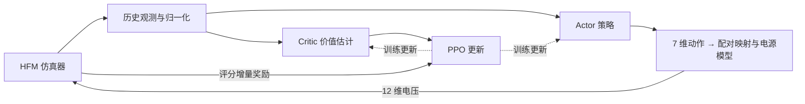

# 1. 项目背景

本项目需要在托卡马克仿真环境中训练神经网络控制器，从**限制器**初始平衡位形出发，在 **500 ms** 内控制等离子体演化为 **XPT** 位形，同时控制等离子体的**电流、位置和边界形状**。

## 1.1 装置结构与线圈

托卡马克用磁场约束环形真空室中的等离子体。等离子体电流与外部线圈共同产生磁场，形成包围等离子体的磁面；控制线圈电压可以改变电流、平衡位置和形状。

| 名称                         | 含义与作用                              | 本项目控制接口      |
| -------------------------- | ---------------------------------- | ------------ |
| TF（Toroidal Field）         | 环向场线圈，产生沿环形装置方向的主要磁场，参与磁约束         | 背景磁场，不在策略动作中 |
| CS（Central Solenoid）       | 中央螺线管，位于装置中心，通过变化的磁通感应环电压，驱动等离子体电流 | 第 1 个电压通道    |
| PF1–PF10（Poloidal Field）   | 极向场线圈，参与控制等离子体位置、形状和磁拓扑            | 第 2–11 个电压通道 |
| VS（Vertical Stabilization） | 垂直稳定线圈，用于快速抑制垂直位移                  | 第 12 个电压通道   |

上述作用相互耦合。本项目将 10 个 PF 通道两两配对，因此策略输出 **7 维动作**（CS、5 组 PF、VS），再映射为 **12 维线圈电压**。


图 1：左侧为环向俯视，右侧为极向截面。线圈位置、数量和尺寸仅作示意；右侧闭合磁面不是本任务的 XPT 目标位形。

## 1.2 柱坐标与二维简化

采用柱坐标 $(R,\phi,Z)$：$R$ 是到装置中心轴的距离，$\phi$ 是绕中心轴的环向角，$Z$ 是竖直坐标。在轴对称近似下，各物理量满足 $\partial/\partial\phi=0$，因此只需求解一个固定 $\phi$ 的 **$R$–$Z$ 极向截面**。这是空间对称性带来的简化，环向磁场 $B_\phi$ 仍然存在。

**LCFS** 是最外层闭合磁面，其截线表示等离子体边界。限制器位形的边界由限制器接触确定；偏滤器位形则具有极向磁场为零的 **X 点**（磁通鞍点）。本项目的 XPT 目标包含主、次级两对 X 点，并使用 8 个打击点描述边界几何。

<p align="center">
  
</p>

图 2：参考资料中的 XPT 磁通截面。蓝色、橙色星号分别标出主、次级 X 点，红色三角标出打击点。图中的矩形边界是计算域边界；本项目打击点是磁通轮廓与该边界相交的几何代理，不等同于真实偏滤器靶板上的热流沉积点。

# 2. 评估指标与评分计算

评测将仿真实际轨迹与官方 `target.json` 中的目标几何比较。总时长为 500 ms，共 $N=500$ 步，每步 1 ms，满分 **30 分**。电流目标由评分代码规定：前 100 ms 从 500 kA 线性下降至 400 kA，此后保持 400 kA；第 $k$ 个评分步对应 $t_k=k$ ms，首步目标为 499 kA。

## 2.1 七项指标

| 指标 | 逐步误差 $\epsilon_i$ | 零分阈值 $\epsilon_i^{\max}$ | 权重／最高贡献分 $w_i$ |
| --- | --- | --- | --- |
| Ip | 等离子体电流相对误差 $\lvert I_p-I_p^{\rm ref}\rvert/\lvert I_p^{\rm ref}\rvert$ | 0.05（5%） | 6 |
| LCFS | 32 个对应边界点的位置 RMS 偏差 | 3 cm | 6 |
| X | 2 个主 X 点的位置 RMS 偏差 | 3 cm | 4 |
| strike | 8 个打击点的位置 RMS 偏差 | 10 cm | 3 |
| psiX | 主 X 点相对实际边界磁通的归一化 RMS 偏差 | 0.003 | 4 |
| X2 | 2 个次级 X 点的位置 RMS 偏差 | 5 cm | 3 |
| psiX2 | 次级 X 点相对实际边界磁通的归一化 RMS 偏差 | 0.005 | 4 |

位置误差统一按下式计算，坐标单位为 m，误差单位为 cm：

$$
\epsilon_{\rm pos}=100\sqrt{\frac{1}{M}\sum_{j=1}^{M}\left[(R_j-R_j^{\rm ref})^2+(Z_j-Z_j^{\rm ref})^2\right]}.
$$

$M$ 是该指标的点数，$j$ 是匹配后的点序号，上标 $\rm ref$ 表示目标。LCFS 按对应采样点比较，不先平移对齐等离子体中心。

磁通指标使用实际观测中的 X 点、边界和磁轴磁通：

$$
\epsilon_{\psi X}=\sqrt{\frac{1}{2}\sum_{j=1}^{2}\left(\frac{F_{X,j}-F_B}{F_B-F_A}\right)^2}.
$$

$F_{X,j}$ 为主 X 点磁通，$F_B$ 为实际边界磁通，$F_A$ 为实际磁轴磁通。`psiX2` 将 $F_{X,j}$ 换成次级 X 点磁通，计算方式相同。

## 2.2 总分计算

每项误差先映射为 $[0,1]$ 内的单步分数：

$$
s_i(k)=\max\left(0,1-\frac{\epsilon_i(k)}{\epsilon_i^{\max}}\right).
$$

再计算加权、约束修正后的 500 步平均分：

$$
S=\frac{\Gamma}{500}\sum_{k=1}^{K}\eta_k\mu_k\rho_k
\left[6s_{Ip}(k)+6s_{LCFS}(k)+\tau_k\left(4s_X(k)+3s_{strike}(k)+4s_{psiX}(k)+3s_{X2}(k)+4s_{psiX2}(k)\right)\right].
$$

其中 $K\leq500$ 为有效仿真步数；提前终止后的剩余步按零分计，分母仍为 500。约束系数为：

| 系数 | 当前评分规则 |
| --- | --- |
| $\eta_k$：位形系数 | `lX == 1` 时为 1，否则为 0.5 |
| $\mu_k$：电流偏差 | 当步电流绝对偏差超过 50 kA 时为 0，否则为 1；后续满足约束可恢复 |
| $\rho_k$：线圈电流 | 任一线圈首次越限后，当步及后续均为 0；CS、PF、VS 限值分别为 45、14、4 kA |
| $\tau_k$：XPT 拓扑 | X 点数 `nX` 四舍五入后等于 4 时为 1，否则为 0，只作用于五项 XPT 指标 |
| $\Gamma$：整段惩罚 | 仿真超时则总分为 0；提供推理耗时时，超过 0.5 ms 的步数多于 50 步也置零，否则为 1；未提供耗时不触发该耗时惩罚 |

榜单中的七项贡献分已经包含权重、时间平均及惩罚，直接相加即为综合分，不再重复加权。

# 3. 仿真器与控制架构

HFM 是一个将轴对称自由边界等离子体平衡与线圈／被动导体回路耦合、按时间步推进的托卡马克控制仿真器。

## 3.1 求解的主要方程

**磁平衡：Grad–Shafranov 方程。** 在等离子体区域内，参考模型使用总极向磁通 $F$ 的约定：

$$
\Delta^*F+4\pi^2\left(\mu_0R^2\frac{dP}{dF}+T\frac{dT}{dF}\right)=0,
\qquad
\Delta^*=R\frac{\partial}{\partial R}\left(\frac{1}{R}\frac{\partial}{\partial R}\right)+\frac{\partial^2}{\partial Z^2}.
$$

$F$ 为总极向磁通（Wb），$P(F)$ 为压强，$T(F)=RB_\phi$ 为环向场函数（不是温度），$\mu_0$ 为真空磁导率。$\Delta^*F$ 描述磁通空间变化，括号内两项分别表示压强梯度和环向场函数对平衡的贡献。自由边界由等离子体电流和外部导体电流共同决定。

极向磁场由磁通导数得到：

$$
B_R=-\frac{1}{2\pi R}\frac{\partial F}{\partial Z},
\qquad B_Z=\frac{1}{2\pi R}\frac{\partial F}{\partial R}.
$$

$B_R$、$B_Z$ 分别是径向和竖直磁场；$2\pi$ 来自总磁通 $F$ 的定义。若改用每弧度磁通 $\psi=F/(2\pi)$，方程系数也要相应改变。

**导体回路：电压驱动电流演化。** 其连续形式为：

$$
M_{ee}\dot{\boldsymbol i}_e+M_{ey}\dot{\boldsymbol i}_y+D_R\boldsymbol i_e=\boldsymbol v_e.
$$

$\boldsymbol i_e$ 是主动线圈与被动导体的电流向量，$\boldsymbol i_y$ 是等离子体网格电流向量；$M_{ee}$ 为导体自感／互感矩阵，$M_{ey}$ 为导体与等离子体的互感矩阵，$D_R$ 为导体电阻对角矩阵，$\boldsymbol v_e$ 为外加电压向量（被动导体分量为零），上点表示时间导数。左侧依次是导体感应电压、等离子体耦合电压和电阻压降。

**等离子体总电流闭合：** 默认零维模型可写为：

$$
L_p\dot I_p+R_p(I_p-I_{\rm ni})+\boldsymbol w^\mathsf{T}M_{ye}\dot{\boldsymbol i}_e=0,
\qquad I_p=\sum_j i_{y,j},\quad \boldsymbol w=\boldsymbol i_y/I_p.
$$

$L_p$、$R_p$ 是等离子体等效电感、电阻，$I_{\rm ni}$ 为非感应驱动电流；$\boldsymbol w$ 为归一化网格电流权重，$M_{ye}$ 描述导体对等离子体的磁耦合，$\mathsf T$ 表示转置。三项分别为感应电压、电阻压降和外部导体耦合电压。求解器通过隐式时间离散联立更新回路电流与自由边界平衡，并非求解完整三维 MHD 演化。

## 3.2 Actor–Critic 控制

本项目用 **PPO** 训练 Actor–Critic 网络：Actor 根据历史观测输出控制动作；Critic 估计当前状态的后续回报，帮助 PPO 计算优势并更新策略。两者各使用两层 256 单元的 Tanh 网络；部署推理时使用 Actor。



下面命令使用 `actions.mode=delta`：策略给出电压增量，经累积、限幅和电源模型后送入仿真器。在本文配置下，4 帧观测与 5 帧动作历史组成 **812 维输入**。每步奖励按比赛评分增量计算；使用相同目标、轨迹和耗时数据时，未归一化、未折扣的整段奖励之和对应比赛得分，PPO 内部仍可对奖励归一化并使用折扣回报。

# 4. 准备工作

在启智平台招生营专项空间中新建交互式建模，选择**标准模式、55 核 CPU**，镜像使用 `subexl50u-new:v2`，将本项目克隆到工作目录。

以下命令均在 **Linux 的 Bash 终端、`plasma-control` 项目根目录**执行。`YOUR_RUN_NAME` 是自定的训练名称，`YOUR_RUN` 是训练生成的完整运行目录名。

复制公共目录中的仿真器压缩包并解压到项目的同级目录，然后激活环境：

```bash
cp ../public/inspire_shared/hfm-runtime-release-sealed-latest.tar .
tar -xf hfm-runtime-release-sealed-latest.tar -C ..
conda activate competition_env
```

后续命令假设仿真器位于 `../hfm-runtime-release-sealed-latest`；若实际位置不同，请替换路径。

# 5. 训练模型

先启动 32 个 HFM socket 实例，对应端口 `2223–2254`。每个环境连接一个独立实例：

```bash
OMP_NUM_THREADS=1 MKL_NUM_THREADS=1 \
  bash ../hfm-runtime-release-sealed-latest/start_hfm_pool.sh \
  --num 32 --base-port 2223
```

各实例日志保存在仿真器的 `logs/hfm_<端口>.log`。等待实例输出 `Waiting for a client to connect...` 后启动训练：

```bash
python train/train_ppo.py \
  output_dir=YOUR_RUN_NAME \
  reset_perturbation.fix_reset_params=true \
  num_envs=32 \
  ports=2223 \
  features.delay_step=1 \
  actions.mode=delta
```

训练产物保存在 `results/` 下的运行目录中。减少环境数时，应同时调整实例数量和 `num_envs`。

# 6. 验证模型

保持端口 `2223` 的 HFM 实例运行并处于空闲状态。将 `YOUR_RUN` 替换为训练生成的运行目录名。

训练至少保存一次 checkpoint 后，可以按 `Ctrl+C` 中断训练，再执行以下命令验证。命令从 `checkpoints/` 中选择训练步数最大的模型，通过 `eval.cp_num` 加载，同时查找对应的 `*_vecnormalize.pkl` 归一化文件：

```bash
RUN_DIR=results/YOUR_RUN

LATEST_CP=$(find "$RUN_DIR/checkpoints" -maxdepth 1 -type f \
  -name 'ppo_f2_*_steps.zip' -printf '%f\n' | sort -V | tail -n 1)

if [[ -z "$LATEST_CP" ]]; then
  echo "没有找到 checkpoint，请检查 $RUN_DIR/checkpoints"
else
  CP_NUM="${LATEST_CP#ppo_f2_}"
  CP_NUM="${CP_NUM%_steps.zip}"
  echo "使用模型：$RUN_DIR/checkpoints/$LATEST_CP"

  python train/evaluate.py \
    eval.model_path="$RUN_DIR" \
    eval.cp_num="$CP_NUM" \
    ports=2223 \
    target.default_reference_path=configs/xpt_reference_targets.json \
    'eval.shots="14795_400"' \
    eval.obs_perturb.enabled=true \
    actions.mode=delta
fi
```

`ppo_f2_latest.zip` 在训练正常结束后保存，中断训练时可能不存在。若要验证正常结束后保存的最终模型，使用：

```bash
python train/evaluate.py \
  eval.model_path=results/YOUR_RUN \
  eval.cp_num=null \
  ports=2223 \
  target.default_reference_path=configs/xpt_reference_targets.json \
  'eval.shots="14795_400"' \
  eval.obs_perturb.enabled=true \
  actions.mode=delta
```

# 7. 可视化结果

验证完成后执行：

```bash
python rollout/visualize_rollout.py --run_name YOUR_RUN
```

# 8. 推理服务与平台提交

`submission` 将训练好的模型部署成 HTTP 推理服务，供评测程序驱动仿真器，生成最终提交的轨迹 JSON。该服务使用 ONNX 模型，不能直接加载 PPO 的 `.zip` 文件。

## 8.1 导出模型

训练中断后，可从 `checkpoints/` 中选择训练步数最大的模型导出。将 `YOUR_RUN` 替换为运行目录名；必须使用同一步数对应的归一化文件：

```bash
RUN_DIR=results/YOUR_RUN

LATEST_CP=$(find "$RUN_DIR/checkpoints" -maxdepth 1 -type f \
  -name 'ppo_f2_*_steps.zip' -printf '%f\n' | sort -V | tail -n 1)

if [[ -z "$LATEST_CP" ]]; then
  echo "没有找到 checkpoint，请检查 $RUN_DIR/checkpoints"
else
  MODEL_PATH="$RUN_DIR/checkpoints/$LATEST_CP"
  VECNORMALIZE_PATH="${MODEL_PATH%.zip}_vecnormalize.pkl"
  if [[ ! -f "$VECNORMALIZE_PATH" ]]; then
    echo "缺少对应的归一化文件：$VECNORMALIZE_PATH，请检查 checkpoint.save_vecnormalize 配置"
  else
    echo "导出模型：$MODEL_PATH"
    python train/export_onnx.py \
      --model "$MODEL_PATH" \
      --out submission/model/policy2.onnx \
      --vecnormalize "$VECNORMALIZE_PATH"
  fi
fi
```

若训练已正常结束，也可以导出最终模型：

```bash
python train/export_onnx.py \
  --model results/YOUR_RUN/ppo_f2_latest.zip \
  --out submission/model/policy2.onnx \
  --vecnormalize results/YOUR_RUN/vecnormalize.pkl
```

导出产物为：

```text
submission/model/
├── policy2.onnx
├── policy2.metadata.json
└── policy2_vecnormalize_stats.npz
```

## 8.2 启动推理服务

启动模型推理 HTTP 服务，供评测程序或外部平台调用训练好的模型。

```bash
pip install -r submission/requirements.txt
python submission/service2.py
```

重新导出模型后，如果推理服务已启动，需停止并重新运行上述服务命令，才能加载新的模型及归一化统计。

默认端口为 `8001`，可通过环境变量 `SUBMISSION_PORT2` 修改。另开终端检查接口：

```bash
curl http://127.0.0.1:8001/health
curl -X POST http://127.0.0.1:8001/reset \
  -H 'Content-Type: application/json' \
  -d '{"episode_id":"F2b"}'
```

每个 episode 先调用 `/reset`，再通过 `POST /act` 发送 `{"observation": {...}}`，返回 12 维物理电压。`/health` 会报告模型输入维度和归一化加载情况；模型或必要统计文件缺失、维度不匹配时返回 HTTP 503，推理异常返回 HTTP 500，不再静默返回零动作。可用环境变量 `SUBMISSION_MODEL_DIR` 指定模型目录。

## 8.3 仿真评测与生成提交文件

在项目根目录打开一个终端，启动本地评测默认连接的 HFM socket 服务（端口 `5558`）：

```bash
LISTEN_PORT=5558 OMP_NUM_THREADS=1 MKL_NUM_THREADS=1 \
  bash ../hfm-runtime-release-sealed-latest/run_hfm_server.sh
```

保持该终端运行，等待输出 `Waiting for a client to connect...`。准备包含本任务目标数据的官方文件 `evaluation/results/target.json`，保持第 8.2 节的推理服务运行，然后在同一计算节点的另一个终端进入项目根目录执行。`PYTHONPATH` 用于确保 Python 能导入项目中的 `environment` 等模块：

```bash
PYTHONPATH="$PWD:$PWD/evaluation/eval:${PYTHONPATH:-}" \
SAISDATA_SHOTS_CONFIG="$PWD/configs/shots.yaml" \
python eval_files/run_test.py --no-build \
  --service-url http://127.0.0.1:8001 \
  --reference-config eval_files/references.yaml \
  --target-json evaluation/results/target.json \
  --output results/submission_infer_result.json
```


上述命令生成 **`results/submission_infer_result.json`**，这是最终提交的仿真轨迹文件；`target.json` 是评分参考文件。

## 8.4 上传平台

在 [比赛平台](https://competition.opensii.ai/) 上传 `results/submission_infer_result.json`，由平台评分并更新排行榜。
