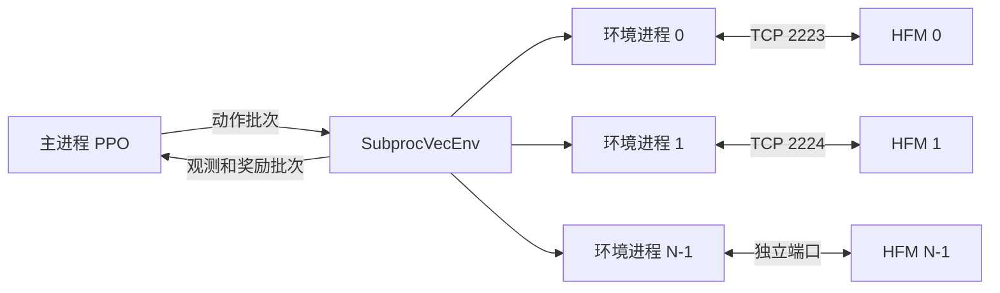

# HFM 控制对象、F1/F2 任务与 PPO_v2 训练技术报告

编写日期：2026-09-19。代码基准：本地工作区，Git HEAD `bd6eb6f8e027189a9569eb4b4fd1893b33876248`。本文中的 PPO_v2 特指 `train_v2/` 入口，不将旧版 `training/train_ppo*.py`、SAC 或复盘中的课程学习方案当作当前实现。

## 阅读范围与证据等级

本文回答三个问题：被控对象如何响应电压、F1/F2 要完成什么、当前策略如何训练并评分。另附通信、日志、部署和实现差异，帮助复现。

- **源码确认**：可以由本工作区 Python、YAML 或 shell 文件直接确认的行为。
- **文档说明**：来自 [enn-retrospective-v3](../enn-retrospective-v3/content.js)、[复赛说明](../README_SEMIFINAL.md) 等资料；与实现不一致时明确指出。
- **物理解释**：依据公开磁平衡理论解释控制机制，不代表已核实封装 HFM 的每个内部算法。
- **待验证**：需要可读的仿真器源码、实际运行环境或闭环实验才能确定。

用户指定的 Runtime 根目录为 `C:/Users/20639/Downloads/hfm-runtime-release-sealed-latest`。实际发布内容位于其下一层同名目录，包括 `matlab/R2024a/`、`sysroot/` 和 `socket_serve/`；服务入口是 `socket_serve/hfm_socket_server.p`，启动脚本是 `socket_serve/hfm_server.sh`。未获得该服务的可读 `.m` 源码，本文没有解密或反编译 `.p` 文件，也没有在 Windows 上启动 Linux HFM 服务。工作区另有同名 Runtime 目录，不能未经比对便认为与用户指定目录完全相同。

本文是静态代码与资料核对报告，不是已完成训练、已验证鲁棒性或真实装置控制的实验报告。正式隐藏评测的具体初态、扰动配置仍以实际发布版本为准。

阅读导航：第1节讲物理和求解框架；第2–3节讲参数、接口、电压范围及扰动；第4节讲任务；第5节讲网络与训练；第6–7节区分reward和最终得分；第8节讲评估可视化；第9–10节记录差异和复现方法；附录提供证据索引与验证记录。

## 1. 控制对象与物理基本原理

### 1.1 控制对象是什么

复盘资料将装置称为玄龙 50U；代码中的初始化路径使用 `TOK_EXL50U/XL50U_fge/`。被控对象可理解为由外部线圈、导电结构和等离子体耦合形成的磁控制系统。策略直接操作电压，目标是控制等离子体电流、边界形状和磁拓扑，不是直接操作温度或聚变功率。

| 名称 | 控制意义 | 当前接口对应 |
|---|---|---|
| CS，中心螺线管 | 磁通变化感应环向电场，与等离子体电流演化相关 | 动作/电流索引 0 |
| PF，极向场线圈 | 调整极向磁场、位置、形状及 X 点结构 | 索引 1–10 |
| VS，垂直稳定控制通道 | 对垂直运动提供较快调节 | 索引 11 |
| 等离子体电流 `Ip` | 自身产生极向磁场，影响平衡与拓扑 | 观测标量，单位 A |
| LCFS | 最后闭合磁通面，描述等离子体边界 | `lcfs_points[32,2]`，坐标单位 m |
| X 点 | 极向磁通的鞍点，与分离界拓扑相关 | `rX/zX/FX/nX` |
| 打击点 | 分离界与承接表面相交的位置 | 在当前代码中由磁通网格边缘交点算法提取 |

线圈之间、线圈与等离子体之间存在磁耦合，所以改变某一路电压并不只影响一个误差。控制过程是“电压改变电流演化，电流改变磁场，磁场与压力重新建立平衡，最终改变可观测位置和边界”。

### 1.2 磁平衡的基本方程

对轴对称、准静态磁平衡，力平衡写成

$$
\mathbf J\times\mathbf B=\nabla p.
$$

采用常见的极向磁通约定，可写

$$
\mathbf B=\frac{1}{R}\nabla\psi\times\mathbf e_\phi+
\frac{F(\psi)}{R}\mathbf e_\phi,
\qquad
\Delta^*\psi=-\mu_0R^2p'(\psi)-F(\psi)F'(\psi),
$$

$$
\Delta^*\psi=R\frac{\partial}{\partial R}
\left(\frac1R\frac{\partial\psi}{\partial R}\right)
+\frac{\partial^2\psi}{\partial Z^2}.
$$

这是 Grad–Shafranov 磁平衡框架。磁轴是磁通极值点；X 点满足极向磁通梯度为零且局部呈鞍形。实际 `FA/FB/Fx` 的磁通符号及是否含 $2\pi$ 因子需要由具体实现的坐标约定确认，不能直接把教科书数值代入。公开 FGE 资料将自由边界磁平衡与外部导体电路、等离子体剖面演化耦合求解。来源：[FGE 论文](https://arxiv.org/html/2512.06847v1)。

### 1.3 电路动力学为何带来“动作后还有持续影响”

作为原理性表达，耦合导体电路可写为

$$
\mathbf u=\mathbf R\mathbf I+\frac{d\boldsymbol\lambda}{dt},
\qquad
\boldsymbol\lambda=\mathbf L\mathbf I+\boldsymbol\psi_{\rm plasma}.
$$

电阻决定耗散，电感和互感使电流不能随指令任意瞬变，等离子体变化又反馈到导体磁链。该表达不是声称 Runtime 内部只积分一个固定 L/R 线性模型；真实自由边界演化通常具有状态依赖的非线性耦合。

控制器需要同时考虑瞬时误差、误差趋势和已经下发但尚未完全体现的动作。历史观测与动作由此有意义，但有限历史并不保证恢复完整物理状态。

### 1.4 仿真器背后的计算原理：能确认到哪一步

EPFL 对 FGE 的说明是：由 PF 电压计算导体电流与等离子体平衡的演化。HFM 的初始化路径及接口与此类模型相符，但路径包含 `fge` 不足以证明它采用公开 FGE 某一版本的所有算法。[MEQ 官方说明](https://www.epfl.ch/research/domains/swiss-plasma-center/meq/)

合理的概念计算链为：

```text
读取装置/炮初始化数据
  → 当前电压驱动耦合电路与等离子体电流演化
  → 更新自由边界磁平衡
  → 提取 Ip、位置、LCFS、磁轴/X 点及诊断量
  → 序列化成 JSON 返回
```

源码可确认的是客户端每次向服务发送 12 个电压数值并接收状态；1 ms 是 Python 电源模型及任务评分采用的外层时间步。下列内部细节无法由 `.p` 发布包核实：

- 是否启用某种 0D/1D 电流扩散模型、如何更新压力剖面；
- 使用 Newton/Picard 中哪种迭代、线性求解器及收敛容差；
- 内部子步长、时间积分阶数、破裂判据与求解失败判据；
- 装置的电阻/电感/互感矩阵、被动导体模型、边界条件及物理尺寸；
- 内部是否另含测量噪声、动作绝对限幅或其他保护。

不能据此宣称 HFM 是全三维 MHD、粒子仿真或神经网络代理。当前控制器将它作为不可微的外部动力学服务使用。

### 1.5 三种位形及任务难点

- **限制器位形**：边界由与限制器接触的条件限定；任务标志 `lX=0`。
- **偏滤器位形**：具有分离界/X 点结构；任务标志 `lX=1`。
- **XPT**：在主 X 点之外引入次级 X 点的先进偏滤器结构，当前 F2 评分要求恰好 4 个 X 点。

`lX=1` 不能替代 `nX=4`。策略可能已形成偏滤器边界，但仍未满足 XPT 拓扑要求。边界几何看起来相近，也不能推出 X 点磁通或打击点均达标。

## 2. 被控对象参数、接口与通信

### 2.1 初始化参数与可控参数的区别

见 [shot_registry.py](../environment/shot_registry.py) 和 [shots.yaml](../configs/shots.yaml)。

| 参数 | 当前确认的用途 | 物理解释的边界 |
|---|---|---|
| `shot_id` | 选择固定文件路径和默认 reset 参数 | 炮号是场景标识，不是策略动作 |
| `L_addr` | 固定装置相关初始化文件路径，当前为 `ini_L_v2.2.mat` | 文件名暗示装置/电感数据，但矩阵内容未核实 |
| `LX_addr` | 选择具体炮的初始状态文件 | 内部状态向量定义未公开 |
| `signeo` | 传入 INIT/RESET 的数值参数 | 命名可能对应新经典电导相关参数，但单位和确切作用未由服务源码确认 |
| `bp` | 传入 INIT/RESET 的数值参数 | 通常命名可指极向比压，不能据此断言 Runtime 的计算定义 |
| `q0` | 传入 INIT/RESET 的数值参数 | 通常可指磁轴安全因子；内部剖面参数化仍待核实 |
| 12D 电压 | 每步控制输入 | 电源处理后进入 HFM |
| `reference_*` | Python 侧任务目标 | 目标不是每步强制设置的物理状态 |

公开 reset 方法只接收 `signeo/bp/q0`；切换 `L_addr/LX_addr` 需要重新初始化相应场景。不要把“改变目标电流”理解为直接修改仿真器实际 `Ip`。

当前注册场景如下；表中参数沿用文件值，未知物理单位不擅自补全。

| 炮号 | 场景标注 | signeo | bp | q0 | 主要用途 |
|---|---|---:|---:|---:|---|
| 13844_500 | 偏滤器 | 7.5e6 | 0.21 | 1.50 | F1/F2 训练 |
| 13844_600 | 偏滤器 | 9e6 | 0.23 | 1.35 | F1/F2 训练 |
| 15892_400 | 限制器 | 5.2e6 | 0.15 | 1.80 | F2b 训练 |
| 15892_500 | 限制器 | 6e6 | 0.19 | 1.44 | F2b 训练 |
| 13906_500 | XPT | 4.8e6 | 0.30 | 1.90 | XPT 场景 |
| 13705_500 | 偏滤器，线上评估标注 | 8e6 | 0.20 | 1.30 | v2 默认评估之一 |
| 14795_400 | 限制器，线上评估标注 | 5.8e6 | 0.21 | 1.81 | v2 默认 F2 评估之一 |

`13906_500` 在 YAML 中重复出现且内容相同；当前 `safe_load` 会保留后一个条目。注册表还可能由环境变量 `SAISDATA_SHOTS_CONFIG` 指向其他文件，实际部署应记录最终解析路径。

### 2.2 三层接口

| 层 | 接口 | 用途 |
|---|---|---|
| Python 环境 | `reset(seed, options)`、`step(action)`、`close()` | PPO 交互 |
| HFM TCP | `INIT / RESET / STEP / EXIT` | 调用动力学服务 |
| 提交 HTTP | `/health /reset /act` | 评测器调用策略服务 |

训练不经过提交 HTTP。训练的进程内/进程间交互由 Gymnasium、SB3 完成，然后各环境通过 TCP 连接 HFM。正式风格评估则多了一层“评测器 HTTP 调用策略”，之后仍由评测器环境把电压送入 HFM。

### 2.3 TCP 协议

源码：[docker_socket_predictor.py](../environment/docker_socket_predictor.py)、[hfm_predictor.py](../environment/hfm_predictor.py)。

| 命令 | 请求内容 | 响应 |
|---|---|---|
| INIT | 命令行 + 初始化 JSON 行 | `INIT_OK` |
| RESET | 命令行 + 可选参数 JSON 行 | 初始观测 JSON 一行 |
| STEP | 命令行 + 空格分隔的 12 个电压值 | 下一观测 JSON 一行 |
| EXIT | 命令行 | 读取结束响应并断开 |

示意请求，数值仅用于解释格式：

```text
INIT\n
{"L_addr":"...","LX_addr":"...","signeo":7500000,"bp":0.21,"q0":1.5}\n
STEP\n
100 10 10 20 20 30 30 40 40 50 50 0\n
```

TCP 是字节流，没有天然消息边界，客户端用换行做分帧。`_send_lines()` 合并命令和参数为一次 `sendall()`，减少服务器读取可选参数的时序竞争；这不是 TCP 保证原子数据包。Python 客户端默认 socket 超时为 300 s。reset 有最多两次尝试，step 路径没有通用的自动重试循环。

Runtime 的 `hfm_server.sh` 调用 `${MATLAB_ROOT}/bin/matlab -batch` 执行 `hfm_socket_server`，允许通过 `MATLAB_ENTRY` 改入口；其默认 `MATLAB_ROOT` 是发布者机器路径，而非自动解析到附带的 `matlab/R2024a`。该脚本定义了日志文件变量，但未见将输出重定向到该文件的命令。因此不能把其他 Runtime 文档中 R2025a、启动池脚本和日志路径直接套用到这份包。

### 2.4 观测接口及 sensor 的含义

这里的 sensor 主要是仿真器返回的诊断/状态量，不全是现实中能无延迟直接测得的传感器通道。Actor 是神经网络策略；actuator 才是物理执行器。两者不要混用。

| 字段 | 形状 | 含义/单位 |
|---|---|---|
| `Ip`, `R`, `Z` | 各 `(1,)` | 电流 A；位置 m |
| `I_PF` | `(12,)` | 按当前约定含 CS/PF/VS 的电流 A |
| `rB`, `zB` | 各 `(32,)` | 边界坐标 m |
| `lcfs_points` | `(32,2)` | Python 将 rB/zB 合并得到 |
| `Rmax/Rmin/aminor/rc/zc` | 各 `(1,)` | 几何长度量 |
| `deltal/deltau/kappa` | 各 `(1,)` | 三角形变、拉长比 |
| `FA`, `FB` | 各 `(1,)` | 磁轴、边界磁通，需遵循 Runtime 约定 |
| `Fx` | `(4290,)` | 66×65 磁通网格的展平数组 |
| `rx`, `zx` | `(66,)`, `(65,)` | 网格坐标 |
| `Bm` | `(100,)` | 磁诊断数组，标定需 Runtime 说明 |
| `rX/zX/FX` | 各 `(6,)` | X 点候选坐标与磁通；前 nX 个有效 |
| `nX`, `lX`, `failure` | 各 `(1,)` | X 点数、位形标志、失败标志 |
| `reference_Ip/R/Z/lX` | 各 `(1,)` | 当前目标 |
| `reference_lcfs_points` | `(32,2)` | 目标边界 |
| `reference_rX/zX/x_valid` | 各 `(4,)` | F2 目标 X 点槽位 |
| `reference_strike_r/z/valid` | 各 `(8,)` | F2 目标打击点槽位 |
| `reference_nX/n_strike` | 各 `(1,)` | 目标数量 |

大小写有意义：`Fx` 是网格，`FX` 是 X 点磁通。HFM 全量观测与 PPO 最终输入不是同一物件；当前 PPO 并没有把 4290 维网格直接送入 CNN。

## 3. 动作范围、电源动态、延迟与噪声

### 3.1 控制信号到底有没有上下界

答案必须分层：策略归一化动作有界；absolute 包装器输出有界；delta 的累积绝对电压没有在训练包装器中限幅；Gym 声明有上下界但 `HFMSimulator.step()` 没有按它自动裁剪；封装 HFM 内部是否另有限幅未知。

7D 到 12D 的映射是

```text
[a0,a1,a1,a2,a2,a3,a3,a4,a4,a5,a5,a6]
```

下表所有电压单位为 V，变化量单位为 V/外层步。后两列为 PSM 的 `u_real=a*u_limited+b`。

| 索引 | 通道 | Gym 声明幅值 | v2 absolute 幅值 | 限速上限 | a | b |
|---:|---|---:|---:|---:|---:|---:|
| 0 | CS | 1499 | 1499 | 239.84 | 0.8580659942 | 245.0691566557 |
| 1 | PF1 | 230 | 172 | 28 | 0.6072767812 | -40.2756786822 |
| 2 | PF2 | 172 | 172 | 28 | 0.6072767812 | -44.2045503841 |
| 3 | PF3 | 172 | 348 | 28 | 0.8035 | -48 |
| 4 | PF4 | 348 | 348 | 28 | 0.8035 | -48 |
| 5 | PF5 | 348 | 270 | 28 | 0.5528314158 | -21.9107201644 |
| 6 | PF6 | 270 | 270 | 28 | 0.5528314158 | -22.5016982305 |
| 7 | PF7 | 270 | 348 | 28 | 0.7901962762 | 72.2624890457 |
| 8 | PF8 | 348 | 348 | 28 | 0.7901962762 | 73.9466700254 |
| 9 | PF9 | 348 | 270 | 28 | 0.8659211512 | 47.0431299209 |
| 10 | PF10 | 270 | 270 | 28 | 0.8659211512 | 51.8093723495 |
| 11 | VS | 270 | 230 | 12.8 | 1 | 0 |

依据：[动作包装器](../train_v2/wrappers.py)、[环境声明](../environment/hfm_simulator.py)、[电源模型](../environment/power_supply.py)。幅值表示对称区间的绝对值，例如 172 对应 [-172,172]。

这些范围并不完全一致。声明 `Box(low, high)` 只描述空间，不能替代实际执行的 `np.clip`。同一对 PF 虽然收到相同指令，但标定截距和随机延迟可不同，实际输出不一定严格相等。

absolute 模式：

$$
v_t=s\odot\operatorname{clip}(a_t,-1,1),\quad
s=[1499,172,348,270,348,270,230].
$$

delta 模式：

$$
v_t=v_{t-1}+D\odot\operatorname{clip}(a_t,-1,1),\quad
D=[239.84,28,28,28,28,28,12.8],\quad v_{-1}=0.
$$

随后映射到 12D。delta 限制的是指令增量，不是总电压；它也不是显式的误差积分控制器。零归一化动作在 delta 模式表示保持指令，absolute 模式表示零指令；由于 PSM 截距存在，零指令通常不等于零实际电压。

### 3.2 动作执行延迟的生成

电源模型对通道 0–10 每步独立从 [2,5] ms 连续均匀采样，对 VS 从 [0,1] ms 采样，再按 1 ms 步长四舍五入。因此 PF 延迟为 2/3/4/5 步，但这些整数并非等概率：理想连续均匀采样下概率约为 1/6、1/3、1/3、1/6。

$$
d_i(t)=\operatorname{round}(\tau_i(t)/\Delta t),\qquad
u_{d,i}(t)=u_{{set},i}(\max(0,t-d_i(t))).
$$

历史不足用首个指令填充。再经过变化率限幅，最后乘 slope、加 intercept。首个电源步因没有前值，会跳过限速；delta 包装器仍然限制其首步增量。

这改变的是仿真输入的时间索引，不执行物理时间 `sleep`。TCP 耗时和 1 ms 的模拟时间是不同概念。固定 `delay_s` 可让 `PowerSupplyModel` 使用固定延迟，但 `HFMSocketPredictor` 当前直接无参数创建模型，训练 Hydra 没有直接暴露这个开关。其随机数发生器未接入每环境的训练 seed，因此固定 PPO seed 不保证完整闭环严格可复现。

### 3.3 训练观测延迟和噪声

`ObservationDelayNoiseWrapper` 位于奖励计算之后、历史特征构造之前：

$$
\tilde o_t^{(j)}=o_{\max(0,t-k)}^{(j)}+\epsilon_t^{(j)},\qquad
\epsilon_t^{(j)}\sim\mathcal N(0,\sigma_j^2).
$$

`k=features.delay_step` 是固定观测延迟，不是随机动作延迟。包装器缓存整个观测字典，包含 `reference_*`，所以参考量也随之延迟。每次取出历史数据后才按 `features.delay_noise_std` 添加逐元素、零均值高斯噪声；未指定字段不加噪声。历史不足时重复初始真实观测，但每次返回可加新的噪声。

例如 Ip 标准差 2300 的单位是 A，LCFS 标准差 0.005 的单位是 m。高斯标准差不是幅值上界，代码不保证受扰边界仍是几何一致的闭合磁通面。噪声在归一化前加入。

默认 `delay_step=0`、`delay_noise_std={}`；任务 YAML 未覆盖它们。README 中 F2 示例额外指定观测延迟 1 步。`features.noise` 虽被传入 `make_env(observation_noise=...)`，但该参数未实际使用，不能靠它启用训练噪声。

数据在线生成：HFM 返回真值，包装器构造受扰观测，策略行动，再获得下一真值和奖励。PPO 存储受扰特征、动作、奖励、价值估计、旧策略 log-prob 等；这里没有预先生成的带标签噪声数据集。Actor 和 Critic 使用同样的受扰特征，Critic 并没有特权真值输入。

### 3.4 环境参数随机化与鲁棒性机制

F1/F2 当前均启用 `apply_mode=all`，三个 reset 参数各乘独立的 Uniform(0.95,1.05)。`fix_reset_params=true` 表示每个环境第一次采样后复用；不同环境可以不同。false 时每回合重采样。改变 seed 或增加并行环境可改变训练覆盖；固定 reset 不会关闭电源延迟随机性。

当前增强鲁棒性的机制为：多炮/多参数联合采样、随机执行延迟、可选测量污染、4 帧观测及5拍动作历史。PPO仍优化平均回报，没有最坏情形优化、显式滤波器、状态观测器、延迟估计器或对抗训练。`VecNormalize` 是尺度归一化，不是去噪。仅在某个固定 k 下训练，也不能保证适应任意观测延迟。

### 3.5 三条链路的扰动实现不能混用

| 链路 | 观测延迟 | 观测噪声 | 电源延迟 |
|---|---|---|---|
| `train_v2/train_ppo.py` | `features.delay_step` 生效 | `features.delay_noise_std` 生效 | 默认每步随机 |
| `train_v2/evaluate.py` | 未接入上述包装器；`eval.obs_perturb` 当前未执行 | 引用不存在的 `RawObservationNoiseWrapper` | 环境层仍默认开启 |
| `eval_files/run_test.py` HTTP 评测 | `delay_steps_from_config()` 固定返回 0 | 顶层 enabled 和 noise.enabled 开启时逐字段加噪声 | 环境层仍默认开启 |

本地 HTTP 评测的 [obs_perturb.yaml](../eval_files/obs_perturb.yaml) 顶层默认 disabled；其示例噪声包括 Ip=2000 A、R/Z=0.01 m、I_PF=50 A、LCFS/rX/zX=0.01 m、FA/FB/FX=0.001（沿用接口单位），以及更小的形状量扰动。它们是本地鲁棒性测试配置，不能写成隐藏评测的确定分布。真实轨迹留在评测器用于算分，仅 HTTP 发送给策略的观测被污染。

## 4. F1、F2a、F2b 任务与控制要求

### 4.1 任务定义

与 [复盘中的“复赛：边改变电流，边完成位形转换”](../enn-retrospective-v3/content.js) 和 [评分常量](../evaluation/eval/score/config.py) 对照：

| 任务 | 初始位形 → 目标 | 总步数/物理时长 | 满分 | 电流目标 |
|---|---|---:|---:|---|
| F1 | 偏滤器 → 限制器 | 300 / 300 ms | 40 | 先保持 500 kA，再降至 200 kA |
| F2a | 偏滤器 → XPT | 500 / 500 ms | 30 | 前 100 ms 从 500 降至 400 kA，之后保持 |
| F2b | 限制器 → XPT | 500 / 500 ms | 30 | 与 F2a 相同 |

令 t 为第 1、2、…个毫秒采样点，则

$$
I_{p,F1}^{ref}(t)=\begin{cases}500000,&t\le100,\\
500000-1500(t-100),&100<t\le300;\end{cases}
$$

$$
I_{p,F2}^{ref}(t)=\begin{cases}500000-1000t,&1\le t\le100,\\400000,&100<t\le500.\end{cases}
$$

评分数组 F2 首值为 499 kA，100 ms 为 400 kA。回合开始前的 500 kA 端点不等于该数组第一个元素。

当前 `build_reference()` 将目标 LCFS 和 F2 XPT 结构作为整段固定目标，仅 Ip 随时间变化；并未实现“边界从初态线性插值到目标”的默认课程。转换期也参与评分，没有前 100 ms 免罚区。

### 4.2 训练配置与评测任务的映射

训练任务键只有 `F1/F2`。`F2` 默认用两种初态共同训练一个模型：偏滤器炮和限制器炮循环分配给环境。只保留 `divertor_start` 可针对 F2a，只保留 `limiter_start` 可针对 F2b；这由 shot_groups 决定，不是另有 F2a/F2b 网络类型。

v2 评估默认 F1 用 `13705_500`，F2 用 `13705_500`、`14795_400`。而 `eval_files/task_references.yaml` 默认仍用训练炮 `13844_500`、`15892_400`。两份评估配置不能视作同一测试集；正式评测也不能仅由炮文件名推断。

### 4.3 高分要求与零分阈值

| 指标 | 定义简述 | 零分阈值 | F1 分值 | F2a/F2b 各自分值 |
|---|---|---:|---:|---:|
| Ip | 电流相对误差 | 5% | 12 | 6 |
| LCFS | 32 个对应点的坐标 RMS 距离 | 3 cm | 28 | 6 |
| X | 两个主 X 点的位置 RMS | 3 cm | — | 4 |
| psiX | 主 X 点相对边界的归一化磁通 RMS | 0.003 | — | 4 |
| X2 | 两个次 X 点的位置 RMS | 5 cm | — | 3 |
| psiX2 | 次 X 点归一化磁通 RMS | 0.005 | — | 4 |
| strike | 八个打击点的位置 RMS | 10 cm | — | 3 |

阈值是该项得分降至零的位置，不是“允许误差范围内满分”。误差越小才越接近满分。LCFS 直接在装置坐标系逐点比较，不平移对齐中心。

另外必须关注：位形不匹配时整步打五折；电流绝对误差大于50 kA时整步清零；任一线圈电流首次超过限制后，该步及未来步全部清零；F2 的五个 XPT 专属项还要求 `nX=4`。

CS、PF、VS 电流上限分别是 45 kA、每路14 kA、4 kA。电压范围、电压变化率上限和线圈电流约束是三个不同概念，不能互相替代。

### 4.4 目标文件和时序风险

训练默认读取 `configs/f1_reference_targets.json` 或 `configs/xpt_reference_targets.json` 的 `reference_*` 格式。HTTP 评测读取 `evaluation/results/target.json` 的 `F1/F2a` 分块格式；F2b 复用 F2a 目标。当前 `build_reference()` 内对公共分块格式的分支已注释，二者不能直接互换。

本次核对时，两个configs参考文件均存在，LCFS均为32×2，终点电流分别为200000 A与400000 A；`evaluation/results/target.json` 在本工作区不存在。HTTP示例配置需补齐其实际目标数据路径，不能直接假设仓库包含完整评测数据。

训练参考数组生成时已从 t=1 ms 开始，而 `HFMSimulator.step()` 先增加 step_count 再读取对应索引。因此第一条 post-step 观测使用数组索引1，即 t=2 ms 的参考；最后索引被截到 N-1。离线评分的第一条 post-step 轨迹对应数组索引0。依当前源码，F1 降流段最多产生一拍1.5 kA、F2 降流段一拍1 kA的参考偏移；应在真实 rollout 中核对时间戳后修正，本文只记录差异。

## 5. PPO_v2 的训练流程与模型架构

### 5.1 项目代码和 SB3 的分工

训练入口：[train_v2/train_ppo.py](../train_v2/train_ppo.py)。

```python
from stable_baselines3 import PPO
policy, ppo_kwargs = build_ppo_init_kwargs(cfg.ppo)
# 中间构造并行环境，并把 learning_rate 替换成调度函数
model = PPO(policy, vec_env, **ppo_kwargs)
model.learn(total_timesteps=..., callback=..., ...)
```

以上为核心调用摘述。`PPO(...)` 创建网络、优化器和 rollout buffer；`learn()` 才执行采样及参数更新。环境、特征、动作、奖励、日志由本项目定义；PPO损失、GAE及反向传播由 Stable-Baselines3 提供。`PPO_v2` 是工程版本，不是重新定义的一种 PPO 算法。

项目依赖只声明 `stable-baselines3>=2.0`，没有锁定远端实际版本。本文使用 SB3 2.7.0 官方源码解释库机制；准确复现必须保存实际安装版本。不能由 TensorBoard 版本推断 SB3/PyTorch 版本。

### 5.2 配置和环境构建

Hydra 按 `base.yaml → task/f1.yaml 或 f2.yaml → 命令行覆盖` 合并。`build_training_context()` 规范化任务名、加载参考、构造扰动参数、循环分配炮号及连续端口。默认使用 trajectory，可选 hold_initial；hold 模式与当前复赛完整转换任务不同。

环境由内到外为：

```text
HFMSimulator
 → EpisodeResetWrapper（或 HoldInitialResetWrapper）
 → NormalizedAction7DTo12DWrapper
 → RewardInfoWrapper
 → 可选 ObservationDelayNoiseWrapper
 → HistoricalOBservationWrapper
 → DummyVecEnv / SubprocVecEnv
 → VecMonitor
 → VecNormalize
 → PPO
```

动作从外向内，观测和奖励从内向外。奖励在观测污染之前计算。`RewardInfoWrapper` 把奖励分量放进 info，供主进程回调记录。

### 5.3 多环境同步并行

单环境用 `DummyVecEnv`；多环境用 `SubprocVecEnv(..., start_method='spawn')`。每个子进程独立维护 HFM 连接、物理状态、reset参数、观测/动作历史、电源内部状态。主进程只有一套 Actor/Critic，批量生成动作，通过进程间通信分发。



32 个环境从2223起连接2223–2254；64个环境连接2223–2286。训练不自动启动这些 HFM 实例。每轮等待各环境返回，所以慢服务会影响总吞吐；1 ms物理步长不能当作每次TCP请求的运行时间。

环境结束时分别自动reset，不要求回合同时结束。一次rollout采集完毕后主进程集中更新网络；当前流程不是边更新边后台采下一批数据，也不是多GPU梯度并行。

### 5.4 观测特征：F1 146维、F2 188维

特征实现：[train_v2/wrappers.py](../train_v2/wrappers.py) 的 `HistoricalOBservationWrapper`。

| 单帧特征 | 维度 | 实际构造 |
|---|---:|---|
| Ip、delta_ip、reference_ip | 3 | Ip，Ip-ref_Ip，ref_Ip |
| lX、delta_lx | 2 | lX，lX-ref_lX |
| 当前LCFS | 64 | 32×2坐标展平 |
| LCFS目标误差 | 64 | 当前坐标减目标坐标 |
| 归一化I_PF | 12 | 各通道电流除以对应电流上限 |
| coil_margin | 1 | max(abs(I_PF)/limit)，实际是利用率而非剩余裕度 |
| **F1小计** | **146** | |
| 4个X点有效性 | 4 | 0/1 |
| X点R/Z误差 | 8 | 乘有效性标记 |
| X点磁通误差 | 4 | (FX-FB)/(FB-FA)，乘有效性标记 |
| nX和实际打击点数 | 2 | 数量值 |
| 8个打击点有效性 | 8 | 0/1 |
| 打击点R/Z误差 | 16 | 乘有效性标记 |
| **F2附加** | **42** | |
| **F2小计** | **188** | |

没有显式加入时间t、未来参考、电流误差积分或R/Z标量；R/Z位置相关信息主要来自完整LCFS。磁通网格可用于XPT预处理，但没有直接作为CNN输入。辅助工具虽能计算磁通梯度，当前188维向量也不含这些梯度。

XPT预处理把候选点放入4个稳定槽位：nX=4时按z降序；数量不等时按参考匹配并标记有效性。主X点槽位为[1,2]，次X点为[0,3]。打击点来自网格边缘的FB等值交点、排序/匹配及8槽补齐，而非原始观测中直接提供的8个物理探头。当前调用指定 `fx_order='C'`，网格展开顺序错误会影响提取结果；不能仅凭MATLAB来源就一律改成F-order。

特征的磁通分母保护是 abs(FB-FA)>1e-9 才取倒数，否则误差置零。奖励/评分采用另一种分母保护，见第6节与第7节。

### 5.5 四帧观测、五拍动作

正常历史填满后，决策输入为

$$
z_t=[f_{t-3},f_{t-2},f_{t-1},f_t,h_{t-5},h_{t-4},h_{t-3},h_{t-2},h_{t-1}].
$$

f包含当前状态与目标误差。如果开启观测延迟k，上述f的物理状态来源相应向前移k步，但动作历史并不会被同一包装器延迟。

| 模式 | 单帧维度 | 状态历史 | 动作历史 | 总维度 |
|---|---:|---:|---:|---:|
| F1 absolute | 146 | 4×146 | 5×7 | 619 |
| F1 delta | 146 | 4×146 | 5×12 | 644 |
| F2 absolute | 188 | 4×188 | 5×7 | 787 |
| F2 delta | 188 | 4×188 | 5×12 | 812 |

复盘中的812维对应 **F2+delta+4帧**，不代表所有任务默认都是812维。任务YAML默认仍为absolute；README示例通过命令行开启delta。

absolute历史保存7D归一化动作；delta历史保存累计并映射后的12D指令 `info['physical_action']`。该名称不能理解为PSM处理后的真实执行电压。reset时为[0,0,0,f0]和全零动作；第一步执行后将第一次动作复制填满5个动作槽，再逐步移入新动作。这些初始化细节必须与部署一致。

### 5.6 Actor/Critic结构

当前为SB3 `MlpPolicy`，两个独立的MLP分支共享同一输入值，隐藏层均为256、256，激活函数Tanh：

```text
输入 z ∈ R^d → VecNormalize
  ├─ Linear(d,256) → Tanh → Linear(256,256) → Tanh → Linear(256,7) → μ(z)
  └─ Linear(d,256) → Tanh → Linear(256,256) → Tanh → Linear(256,1) → V(z)
```

Actor输出均值，并有可训练的7维log_std参数；在当前 `use_sde=false` 的默认对角高斯下，标准差不是另一个由状态生成的网络头。初始log_std=-1，即sigma≈0.3679。训练采样动作，确定性推理用均值；环境动作裁剪与PPO概率比裁剪是两种不同操作。输出均值头不是通过Tanh强制压入[-1,1]的隐藏层。

按标准全连接权重/偏置计数，F2 delta的812维配置：Actor均值网络275719参数，加7个log_std后275726；Critic274177；总计549903。此数不含优化器状态，且以未替换SB3标准网络为前提。

### 5.7 PPO/GAE算法细节

PPO交替执行“按旧策略采样一批数据”和“对该批数据多轮小批量优化”。它没有SAC式跨许多轮保存旧经验的长期replay buffer。依据：[PPO原始论文](https://arxiv.org/abs/1707.06347)。

设网络输入为z，训练用的奖励为经过VecNormalize后的r，GAE使用TD残差

$$
\delta_t=r_t+\gamma V(z_{t+1})-V(z_t),\qquad
\hat A_t=\sum_{l=0}^{L-1}(\gamma\lambda)^l\delta_{t+l},\qquad
\hat R_t=\hat A_t+V(z_t).
$$

终止、截断和rollout尾端需按库的bootstrap逻辑处理，不能把公式跨回合直接相加。GAE利用多步价值估计折中偏差与方差；当前lambda=0.95、gamma=0.995。[GAE原始论文](https://arxiv.org/abs/1506.02438)

对采样时保存的旧log-prob构造概率比

$$
q_t(\theta)=\exp[\log\pi_\theta(a_t|z_t)-\log\pi_{old}(a_t|z_t)],
$$

$$
L_{policy}=-\mathbb E\left[\min\left(q_t\hat A_t,
\operatorname{clip}(q_t,1-\epsilon,1+\epsilon)\hat A_t\right)\right].
$$

价值损失及总损失为

$$
L_V=\mathbb E[(V_\theta(z_t)-\hat R_t)^2],\qquad
L=L_{policy}+c_vL_V-c_e\mathbb E[H(\pi_\theta)].
$$

当前epsilon=0.2，cv=0.5，ce=0；熵项系数为0不意味着没有动作采样噪声。优势在小批次中归一化，梯度范数上限0.5。`clip_range_vf=null` 不启用价值裁剪；`target_kl=0.03` 是早停目标，SB3 2.7.0源码以近似KL超过1.5倍目标判定早停，并非每次更新严格投影到KL≤0.03。[SB3 PPO源码](https://stable-baselines3.readthedocs.io/en/v2.7.0/_modules/stable_baselines3/ppo/ppo.html)

### 5.8 当前默认训练参数

| 参数 | F1 | F2 | 说明 |
|---|---:|---:|---|
| total_timesteps | 32768000 | 32768000 | 所有环境交互步数之和 |
| num_envs | 64 | 32 | 用户F1命令覆盖为32 |
| n_steps | 256 | 256 | 每环境每次采样长度 |
| rollout样本量 | 16384 | 8192 | num_envs×n_steps |
| batch_size | 1024 | 1024 | 更新小批量 |
| n_epochs | 6 | 6 | 每批最多遍历6次 |
| 峰值learning_rate | 3e-4 | 1e-4 | warmup后余弦下降 |
| gamma / gae_lambda | 0.995 / 0.95 | 同左 | 回报与优势参数 |
| clip_range / target_kl | 0.2 / 0.03 | 同左 | 策略更新控制 |
| ent_coef / vf_coef | 0 / 0.5 | 同左 | 损失权重 |
| use_sde | false | false | 普通高斯策略 |
| seed | 0 | 0 | 并不控制所有电源随机性 |
| history_steps | 4 | 4 | 当前任务覆盖 |
| actions.mode | absolute | absolute | README推荐示例覆盖delta |

32环境时每轮8192条，8个minibatch×6轮，最多48次梯度更新；默认64环境F1为16×6=96次。总预算对应约4000或2000个完整rollout批次。每回合300/500步与每批256步不是一个概念。

`warmup_cosine_schedule()` 以10个rollout批次为warmup，从峰值学习率的1/10升至峰值，之后余弦下降到预算末端接近0。32环境warmup为81920总环境步，64环境为163840步。长时间续训应核实重置步数及调度器进度，不能仅看“又跑了几百万步”。

### 5.9 归一化、保存、续训

观测按在线均值/方差标准化并裁剪到[-10,10]；奖励按折扣累计回报的运行方差缩放并裁剪到[-10,10]，不是简单减去瞬时reward均值。奖励r、原始reward日志和官方分数有不同尺度。评估时冻结统计量并设置 `norm_reward=false`。[VecNormalize源码](https://stable-baselines3.readthedocs.io/en/v2.7.0/_modules/stable_baselines3/common/vec_env/vec_normalize.html)

输出位于 `results/<时间戳>_<output_dir>/`，保存 `configs.pkl`、模型zip、`vecnormalize.pkl`、统计量npz、monitor和checkpoints。模型与对应归一化统计量必须配套。

续训使用 `PPO.load(..., env=vec_env, custom_objects=ppo_kwargs)`。当前代码将 `reset_num_timesteps=bool(resume.enabled)`，没有读取同名的 `resume.reset_num_timesteps` 配置值；因此仅修改配置字段未必改变行为。重新设置log_std_init也不能直接等价为重置已加载模型的探索方差。

## 6. 训练reward：完整计算过程

### 6.1 先统一误差定义

令当前电流为$I$，目标为$I_r$；边界点为$p_j$，目标$p_j^r$。正常数据下：

$$
e_I=|I-I_r|/\max(|I_r|,1),\qquad
e_L=100\sqrt{\frac1{32}\sum_{j=1}^{32}\|p_j-p_j^r\|_2^2}.
$$

位置误差乘100转cm。主/次X点使用两点位置RMS，打击点使用8点RMS。X点磁通误差：

$$
e_\psi=\sqrt{\frac1m\sum_{j=1}^m
\left(\frac{\psi_{X,j}-\psi_b}{\psi_b-\psi_a}\right)^2}.
$$

这里目标不是“目标X点本身的某个磁通常数”，而是当前X点与当前边界磁通的相对一致性。训练奖励在 abs(FB-FA)≤1e-12 时把分母替换为1；与观测特征置零的保护不同。

### 6.2 两种子得分函数

令$x=e/e_{max}≥0$，当前 `_score()` 有两种行为：

$$
s_{\text{official}}(x)=\max(0,1-x),
$$

$$
s_{dense}(x)=\begin{cases}2-x,&0\le x\le1,\\
\exp(1-x),&x>1.\end{cases}
$$

`score_lower_bound=true` 使用前者；当前F1/F2均false，训练使用后者。阈值内是线性的，误差为0得2分、达到阈值得1分；阈值外仍给正奖励并逐渐衰减。它在阈值处连续且一阶导数连续，不是存在跳变的奖励。

| e/e_max | 官方子得分 | 当前dense子得分 |
|---:|---:|---:|
| 0 | 1 | 2 |
| 0.5 | 0.5 | 1.5 |
| 1 | 0 | 1 |
| 2 | 0 | 0.367879 |

因此TensorBoard的 `ip_score/lcfs_score` 不能直接当作官方0–1子分。

### 6.3 正常步的奖励组合

先按当前配置权重加权平均：

$$
\bar s_t=\frac{\sum_jw_j\tilde s_{j,t}}{\sum_jw_j},
$$

其中X点/打击点dense子分还乘对应有效槽位比例。F1权重为$I_p$=0.3、LCFS=0.7；F2如下：

| 分量 | 训练权重 | 官方F2权重 |
|---|---:|---:|
| Ip | 6 | 6 |
| LCFS | 6 | 6 |
| 主X点位置 | 4 | 4 |
| 主X点磁通 | 4 | 4 |
| 次X点位置 | **4** | **3** |
| 次X点磁通 | **3** | **4** |
| 打击点 | 3 | 3 |

次级位置/磁通权重在训练配置与官方评分之间对调。这是当前具体配置差异，不应写成完全一致。

电流软门控：

$$
m_{soft}(\Delta I)=\begin{cases}
1,&\Delta I\le50000,\\
(100000-\Delta I)/50000,&50000<\Delta I\le100000,\\
0,&\Delta I>100000.
\end{cases}
$$

位形乘数eta：四舍五入后的lX与目标一致为1，否则0.5。正常训练步最终为

$$
r_t=\eta_t\,m_{soft,t}\,\bar s_t.
$$

这个$r$在正常有限数据下约处于[0,2]，之后才由VecNormalize缩放。若 `use_competition_score=true`，正常步改用下面的评分代理，失败/超限分支仍存在。

### 6.4 提前终止与被注释的奖励项

`failure>0.5` 时记录failure_penalty，默认-5；环境通常同时传入terminated。线圈最大利用率≥1时记录coil penalty=-5并强制terminated。若二者同时发生，后执行的coil分支会覆盖前面的reward与日志字典。非有限的最终正常步reward回退到-5。

`alive_offset`、额外 `topology_score` 加项、`ip_error_boundary_penalty`、动作L2/平滑惩罚均未参与当前正常步reward表达式；部分键虽然在YAML出现，代码已注释。电流熔断超过50 kA本身不立即终止训练，只影响门控；线圈触限则终止。

F2有效点处理还需注意：当前位置RMS先对固定槽位集合求均值，再乘有效比例，并不是严格只对有效点计算RMS；打击点目标有效性读取的是 `reference_n_strike>0.5` 标量而不是8维 `reference_strike_valid`。目标全有效时影响有限，稀疏目标时需核对。

### 6.5 日志中的 competition_score

F1：

$$
c_t=\eta_t\mu_t\rho_t(0.3s_{I,t}+0.7s_{L,t}).
$$

F2：

$$
c_t=\frac{\eta_t\mu_t\rho_t}{30}
[6s_I+6s_L+\chi_t(4s_X+4s_{\psi X}+3s_{X2}+4s_{\psi X2}+3s_S)].
$$

这里s用官方线性截零，mu为绝对电流误差≤50 kA，chi为nX==4；代码的XPT子分分支中已乘chi，公式只是整理后的表达。rho来自奖励对象的线圈标志。终止分支在生成正常competition_score之前返回，所以对应日志可能没有这一列。

该c_t是归一化单步代理，不是整任务总分。若所有时序、目标、提取和终止处理完全一致，完整轨迹可按F1的40/N或F2的30/N累加c；但当前已有时序、边界与日志缺失差异，最终分数应重新走独立评分器。

## 7. 控制结束后，最终评分如何计算

### 7.1 评分器输入与数据来源

实现目录：[evaluation/eval/score](../evaluation/eval/score/)。入口 `evaluate(trajectories, targets)`，而不是Actor自己预测得分。

```text
真实post-step观测序列
  → trajectory_utils提取轨迹
  → tasks.compute_epsilons_for_task
  → penalties计算位形/电流/拓扑/超时系数
  → scoring.task_score
  → 三项任务分数求和
```

关键输入有 `Ip`、`lcfs_per_step`、`Icoil`、`lX`、`nX`、主次X点、打击点和磁通；K_eff取关键已提供数组的最短有效长度，并不直接读取 `f_surv` 作为额外乘数。Ip参考由评分器按任务公式重新生成，不接受任意训练参考来改变比赛目标。

### 7.2 各种乘数的精确定义

| 符号 | 计算逻辑 | 后果 |
|---|---|---|
| eta_t | F1要求lX==0，F2要求lX==1；不满足为0.5 | 位形不对，整个当步减半 |
| mu_t | abs(Ip-Iref)≤50000为1，否则0 | 只清零不达标的当步；后续可恢复 |
| rho_t | 首次任意abs(Icoil)>limit起永久为0 | 超限步及后续全部清零 |
| chi_t | round(nX)==4为1，否则0 | 只屏蔽F2的5个XPT专属指标 |
| G_time | 未传推理耗时数组时为1 | 与RL的gamma无关 |
| timeout | 若为true，整个子任务0分 | 不仅丢失某一步 |

训练coil触发条件为≥，评分为>，在恰好触限时不同。评分eta直接比较lX，而训练先round。

源码虽注释“本期不评分”，但若确实传入 `inference_time_ms`，`compute_gamma()` 会检查超过0.5 ms的步数占N的比例是否大于10%，超过则G_time=0。未提供该数组的普通路径为1。HTTP协议超时是另一个独立机制：本地runner默认从第二次act开始设置5 s超时，首次act和reset不设该HTTP超时；相关异常或ok=false被标成timeout。0.5 ms、5 s、HFM socket 300 s分别属于不同层。

### 7.3 最终公式

先令各指标未加权得分为s=max(0,1-e/e_max)，对F2专属项乘chi，定义为s'。则

$$
S_{task}=\frac{G_{time}}N
\sum_{t=1}^{K_{eff}}\eta_t\mu_t\rho_t
\sum_jW_j s'_{j,t}.
$$

如timeout=true直接返回0。分母固定为N=300或500，提前终止后未运行步按0计。最终

$$
S_{total}=S_{F1}+S_{F2a}+S_{F2b},\qquad S_{total}\le100.
$$

不要再额外乘一次存活比例，否则会重复扣减；也不要把每个rollout的30分直接累加当成多个不同子任务的官方100分。

### 7.4 数值例子

**F1单步例子。** 目标500 kA，误差10 kA，电流相对误差2%，电流子分0.6；LCFS误差1.5 cm，边界子分0.5。位形正确、无超限时，该步加权得分为12×0.6+28×0.5=21.2。若整段300步都具有同样的相对误差和边界误差，则任务得21.2/40。

相同状态下dense训练奖励为0.3×1.6+0.7×1.5=1.53；归一化competition_score为0.53；最终任务得分为21.2。这三个数字不是同一尺度。

**存活例子。** 某F2轨迹只运行261/500步，有效步平均加权分16.5383/30，未额外触发其他门控，则总分16.5383×261/500≈8.6330/30。即使存活期间平均分不变，提高存活长度也能明显提高总分。

**XPT拓扑例子。** F2若全程nX不为4，即使Ip和LCFS完美且位形正确，其他5个指标全部清零，满500步也最多12/30。

**线圈例子。** F2若第251步第一次超过电流限制，且前250步均满分，则最多250/500×30=15分；后续电流恢复正常也不能恢复该回合的rho。

## 8. 评估、部署与可视化

### 8.1 v2本地模型评估

`train_v2/evaluate.py` 加载PPO zip和配套VecNormalize，默认确定性动作、冻结归一化、关闭reward归一化。运行轨迹后输出到 `<model_path>/eval/`：

```text
step_reward_components.csv
rollout_observations.npz
rollout_summary.csv / rollout_summary.json
infer_result.json
score_summary.json
```

`score_summary.json` 对各rollout逐个评分，再给出均值/最小/最大值，不能等价成三任务合计100分。`infer_task_id()` 根据炮号前缀识别限制器任务；当前main按整个shots集合推断一次任务类别，混合初态评估时也应核实逐炮标签。

### 8.2 提交服务闭环

F1路由到service1端口8000，F2a/F2b到service2端口8001；外部容器映射端口可不同。`/act`请求包含观测字典，响应包含12D action。服务层检查长度，当前 `inference_common.py` 另按其动作范围做裁剪；它的7D幅值 `[1499,230,172,172,348,348,270]` 与v2 `[1499,172,348,270,348,270,230]` 不一致。

现有提交代码使用另一套metadata/历史预处理，也未见与v2 delta完全一致的累计电压逻辑。因此“将v2模型导出ONNX放进去”不保证等价部署；需要核对输入顺序、维度、历史填充、归一化、delta状态、映射和电压尺度。本文没有修改或声称已打通该链路。

### 8.3 训练曲线与物理轨迹

训练使用WandB项目 `f1_control/f2_control`，成功初始化后设置TensorBoard目录 `runs/<wandb_id>/`。`RewardComponentsCallback` 从info按窗口统计原始奖励分量，记录到SB3 logger并可直接发送WandB。`monitor.csv` 在VecNormalize外层包装之前记录原始episode奖励和长度。

```bash
# 在训练项目目录查看所有实验
tensorboard --logdir "$PWD/runs" --port 6006 --load_fast=false
# 检查是否真正写入指标
tensorboard --inspect --logdir "$PWD/runs"
# 已生成评估数据后，绘制指定运行目录
python rollout/visualize_rollout.py --run_name 完整运行目录名
```

这些是使用示例，没有在本报告编写过程中启动服务。6006仅为网页监听端口，与HFM端口及训练run选择无关。多run可由TensorBoard筛选；图中Value已经是采样均值，Smoothed再做显示平滑。

可视化输出在 `results/<run>/eval/figures/`，包括各分量PNG、`ip_vs_reference.png` 和 `lcfs_rollout.mp4`。视频需要FFmpeg。训练曲线横轴为采样总步数，评估曲线横轴为某一回合的控制步，二者不能混看。

注意：训练 `logs/reward_components.csv` 当前只写表头，追加行代码被注释；关闭WandB且不另设 `ppo.tensorboard_log` 时不一定有TensorBoard事件数据。`hfm_timeout_rate=0` 只表示收到的info未带超时标记，不证明底层从未发生通信错误。

## 9. 已确认的实现差异与复现风险

本节是对当前实现的记录，不是本次已完成的修复。它们影响如何解释训练结果和报告结论。

| 项目 | 当前事实 | 影响 |
|---|---|---|
| training包导入 | `__init__.py`导入不存在的load_target_reference | v2训练入口可能在建环境前失败 |
| v2评估导入 | 引用不存在的RawObservationNoiseWrapper | 当前文件无法原样完成导入 |
| v2评估动作历史 | HistoricalOBservationWrapper未传action_mode | delta训练644/812维与默认评估619/787维不一致 |
| 评估配置恢复 | 文件头称读configs.pkl，main未实现读取 | 不能假定评估自动继承训练配置 |
| 观测污染 | 三条链路实现不同 | 开一个配置不代表各处都加了相同扰动 |
| 参考格式 | build_reference未启用官方分块格式分支 | eval默认目标路径即使存在也需检查格式 |
| HTTP目标数据 | 默认evaluation/results/target.json在本工作区不存在 | 默认HTTP评估配置需提供目标文件 |
| 参考时间索引 | step_count递增后取索引 | 对训练reward与独立评分造成一拍偏差 |
| 电压尺度 | Gym、v2、submission三处不同 | 控制范围及部署可能不等价 |
| delta总电压 | 只裁剪增量，未裁剪累计值 | 可能出现长期漂移，不能声称受Gym限幅保护 |
| F2 reward权重 | 次X位置/磁通4/3，评分3/4 | 训练优化取舍与最终评分不同 |
| 无效槽位 | 部分奖励未只对有效点求RMS | 目标稀疏或拓扑变化时需检查 |
| 线圈门槛 | 训练≥、评分> | 精确触限行为不同 |
| 随机种子 | 电源默认独立无显式seed | 固定训练seed不等价于固定所有随机性 |
| 续训计数 | reset_num_timesteps由resume.enabled决定 | 同名配置项未被实际读取 |
| checkpoint频率 | rollout结束时检查n_calls % save_freq | save_freq=10并非直观的每10个rollout |
| 物理内核 | 用户Runtime为.p且启动脚本路径需适配 | 数值算法与隐藏限制无法完整审计 |

checkpoint默认n_steps=256、save_freq=10时，n_calls在rollout末依次为256、512、768…，首次满足取模条件在第5个rollout；保存发生于rollout结束回调，按标准SB3流程在该批优化之前。因此checkpoint文件名的步数代表已采样量，不能直接解读为刚用这些样本完成了优化。

## 10. 建议的复现与结果核对清单

此处是后续执行清单，本次报告未运行HFM闭环。

1. 记录实际Git提交、Python/SB3/PyTorch/Gymnasium/Hydra版本，以及Runtime服务文件的校验值。
2. 确认用的是哪个Runtime目录、MATLAB_ROOT、初始化文件和shots配置；确认端口数与num_envs一致。
3. 先解决第9节会阻塞运行的接口问题，再执行少步smoke；当前smoke函数含breakpoint，非无人值守流程。
4. 打印实际观测维度，逐字段对照619/644/787/812及特征顺序；记录是否delta、是否观测延迟及噪声。
5. 同时记录7D策略动作、12D指令、电源实际输出和I_PF，区分策略裁剪、电源限速与电流约束。
6. 对齐首步、100 ms拐点和最后一步的参考时间索引；评分参考与训练参考逐元素比较。
7. 用保存的原始轨迹重新算分，检查每项误差、eta/mu/rho/chi、K_eff与固定分母，不只看训练平均reward。
8. 将checkpoint与当时的VecNormalize一起评估；多种子报告均值、离散程度、最差分及完整存活率。
9. 比较确定性策略在固定执行延迟、随机执行延迟、观测噪声和未见初态下的结果，分别辨别偏差与随机方差。
10. 用相同初态、观测序列检验Python策略与提交策略的逐步动作，避免ONNX输出正常但预处理/累计状态不同。

如果没有真实轨迹、控制器权重和扰动对照结果，只能分析潜在瓶颈，不能宣称已经测得“PPO精度上限”或真实装置鲁棒性。

## 附录A：源码阅读地图与外部依据

下列相对链接均从本文所在docs目录出发，便于随仓库移动。

| 来源 | 本文使用范围 |
|---|---|
| [enn-retrospective-v3/content.js](../enn-retrospective-v3/content.js) | 任务故事、F1/F2转换、812维设计与算法路线 |
| [README_SEMIFINAL.md](../README_SEMIFINAL.md) | 复赛接口与任务要求 |
| [docs/reference.md](reference.md) | 观测字段与接口语义；默认值需以代码复核 |
| [environment/hfm_simulator.py](../environment/hfm_simulator.py) | Gym接口、空间声明、参考索引、reward调用 |
| [environment/hfm_predictor.py](../environment/hfm_predictor.py) | 电源模型接入、返回值解析 |
| [environment/docker_socket_predictor.py](../environment/docker_socket_predictor.py) | TCP协议、连接与超时 |
| [environment/power_supply.py](../environment/power_supply.py) | 延迟、限速、标定 |
| [configs/shots.yaml](../configs/shots.yaml) | 场景与参数数值 |
| [environment/xpt_utils.py](../environment/xpt_utils.py) | X点匹配、磁通网格、打击点提取 |
| [train_v2/train_ppo.py](../train_v2/train_ppo.py) | 配置、环境、SB3、续训、保存 |
| [train_v2/wrappers.py](../train_v2/wrappers.py) | 观测/动作历史、噪声、delta |
| [train_v2/rewards.py](../train_v2/rewards.py) | dense reward与competition_score |
| [基础配置](../train_v2/configs/base.yaml)、[F1配置](../train_v2/configs/task/f1.yaml)、[F2配置](../train_v2/configs/task/f2.yaml) | 默认超参数和任务覆盖 |
| [training/references.py](../training/references.py) | 参考文件加载与Ip曲线 |
| [training/callbacks_x.py](../training/callbacks_x.py) | 日志统计与checkpoint时机 |
| [train_v2/evaluate.py](../train_v2/evaluate.py) | v2模型评估与评分汇总 |
| [eval_files/subtask_runner.py](../eval_files/subtask_runner.py)、[obs_perturb.py](../eval_files/obs_perturb.py) | HTTP控制闭环与评估噪声 |
| [评分config](../evaluation/eval/score/config.py)、[metrics](../evaluation/eval/score/metrics.py)、[penalties](../evaluation/eval/score/penalties.py)、[scoring](../evaluation/eval/score/scoring.py) | 最终评分的四层逻辑 |
| [submission/inference_common.py](../submission/inference_common.py) | 当前提交预处理和动作裁剪 |
| [rollout/visualize_rollout.py](../rollout/visualize_rollout.py) | 离线图片与视频 |

外部依据用于解释原理，不用于替代本项目实现证据：

- [EPFL MEQ/FGE官方说明](https://www.epfl.ch/research/domains/swiss-plasma-center/meq/)：电压驱动导体电流及平衡演化。
- [FGE论文与全文](https://arxiv.org/abs/2512.06847)：自由边界磁平衡、电路和剖面演化的通用框架；不等于本Runtime采用全部选项。
- [PPO论文](https://arxiv.org/abs/1707.06347) 与 [GAE论文](https://arxiv.org/abs/1506.02438)：算法基础。
- [SB3 2.7.0 PPO源码](https://stable-baselines3.readthedocs.io/en/v2.7.0/_modules/stable_baselines3/ppo/ppo.html) 与 [VecNormalize源码](https://stable-baselines3.readthedocs.io/en/v2.7.0/_modules/stable_baselines3/common/vec_env/vec_normalize.html)：库实现对照，远端版本需另行确认。

## 附录B：与复盘内容的对应关系

| 复盘说法 | 当前代码核对结果 |
|---|---|
| 4帧状态+5拍动作，812维输入 | F2、delta、history=4时成立；F1不适用 |
| 两个256、256的MLP分支 | 当前SB3配置成立 |
| 每环境采样256步 | 当前任务覆盖成立 |
| 一步观测延迟 | README部分F2命令启用；任务默认0；HTTP本地评测显式关闭 |
| 有限增量动作 | delta模式成立；累计绝对电压未限幅 |
| 多初态/参数增强 | 有实现；固定reset时为每环境固定样本 |
| SAC/LSTM/经验回放与切换 | 属复盘其他路线，不在当前v2 MlpPolicy训练主链路中 |
| 评分体现精度与存活 | 成立；需用真实轨迹和固定N分母重新计算 |

复盘的解释可用于理解设计意图；具体运行行为应由配置解析结果、实际执行代码和原始轨迹共同确定。

## 附录C：报告验证记录

编写时已执行以下只读核验，未启动HFM、未训练或修改控制算法：

- 逐个检查报告本地Markdown链接，均能解析到已有文件或目录。
- 直接调用本地 `score.scoring.task_score` 和 `score.penalties.compute_rho` 验证三组算例：F1=21.2分、F2无四X点拓扑=12分、F2第251步首次超限=15分。
- 独立复算812维网络参数量：Actor含log_std共275726，Critic274177，总549903。
- 读取参考JSON，确认目标电流终值与LCFS维度；确认默认公共目标文件缺失。
- 检查Markdown代码块与数学块成对闭合，核对报告覆盖用户要求的三部分。

用户指定发布目录中服务文件的身份记录如下，便于与远端版本对照；这些校验值不代表内部模型正确性证明：

| 文件（相对发布内容目录） | 字节数 | SHA-256 |
|---|---:|---|
| socket_serve/hfm_socket_server.p | 2083 | daf75df725421b959c53ebe1a45a9add2f508ac0b32480a232d3707cef28fee2 |
| socket_serve/hfm_server.sh | 788 | 5a305c0069526184195c59b856c47cf79fdba16dc9bd91d4af9e060824e5abea |

以上验证支持接口/公式解释，不构成模型在实际HFM中控制精度、稳定性或实时性的验证。
