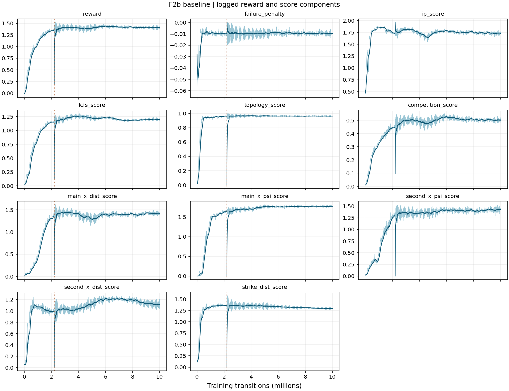
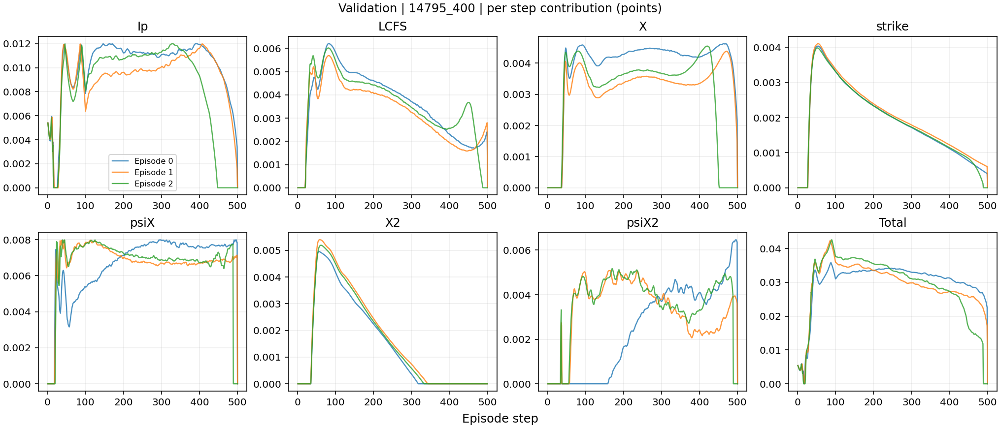
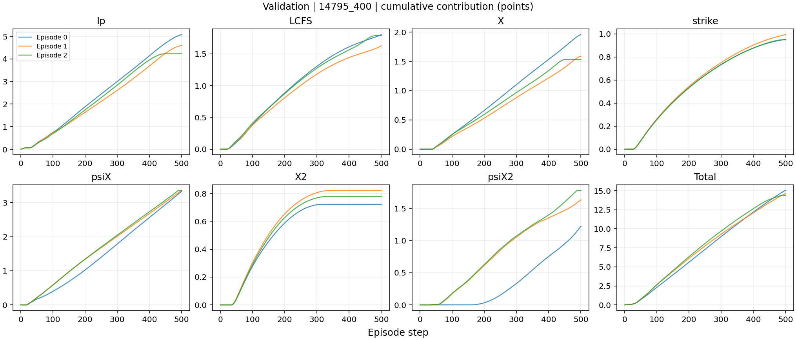
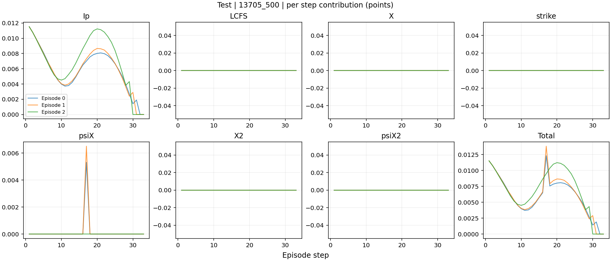
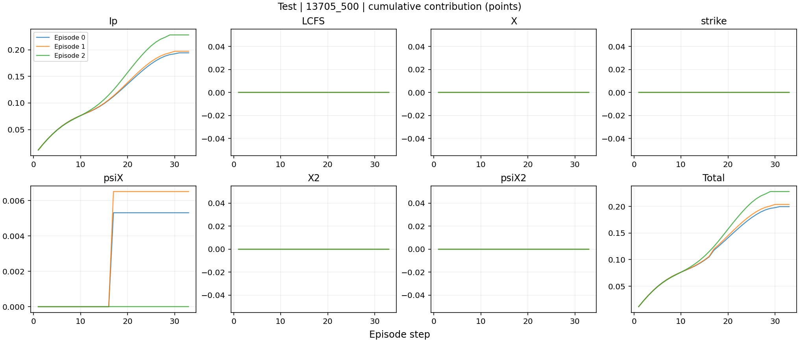

# F2b 历史观测 baseline 实验报告

PPO 在两个训练 shot 上累计采样 10,002,432 步。最终策略在已见 shot 得到 16.73/30 分，在留出的验证 shot 得到 14.69/30 分。在另一留出 shot 上，三个回合均于第 29–31 步失败，平均只有 0.21/30 分。

## 设置与训练

训练 shot 为 `15892_400` 和 `15892_500`，seed 为 0。32 个并行环境使用四帧历史，actor 的 7 维 delta 动作经映射和电源模型转换为 12 维电压。每次 reset 对 signeo、bp、q0 独立施加 ±5% 扰动。使用原 F2 dense reward 和 MLP critic。训练曾在 2,211,840 步处从 checkpoint 恢复。完整配置和运行命令见 [实验记录](README.md)。



浅线为每次日志记录，深线为最近 20 条记录的均值，竖虚线为续训点。横轴是 32 个环境累计采样步数。各子图保留自己的纵轴。训练日志中的 competition_score 是训练期指标，正式成绩另用完整回合轨迹按 30 分制计算。

## 正式评估

每个 shot 跑三个 episode，评估时加入标准差为 2300 A 的电流噪声和 0.008 m 的径向位置噪声。下表分项均为对三个回合取平均后的正式贡献分。

| 划分 / shot | seed | 实际步数 | Ip | LCFS | X | strike | psiX | X2 | psiX2 | 综合分 / 30 |
|---|---|---|---:|---:|---:|---:|---:|---:|---:|---:|
| 已见 15892_400 | 100–102 | 499 / 499 / 499 | 4.613 | 1.454 | 1.981 | 1.353 | 3.593 | 1.339 | 2.394 | 16.727 |
| 验证 14795_400 | 200–202 | 499 / 499 / 499 | 4.634 | 1.739 | 1.692 | 0.964 | 3.341 | 0.774 | 1.541 | 14.685 |
| 测试 13705_500 | 300–302 | 31 / 30 / 29 | 0.206 | 0.000 | 0.000 | 0.000 | 0.004 | 0.000 | 0.000 | 0.210 |

### 验证 shot




每条线是一次推理。逐步贡献已包含权重、约束系数和 500 步分母；逐步相加得到累计曲线，最后一个值就是该项正式得分。三个回合总分分别为 15.044、14.607、14.404。相对已见 shot，次级 X 点磁通 psiX2 和次级 X 点位置 X2 的平均贡献分别减少约 0.85 分和 0.57 分。

### 测试 shot




三个回合总分分别为 0.200、0.204、0.228，均记录为仿真失败，HFM 超时标志均为 false。测试图放大到最后一次终止附近；终止后到第 500 步，单步贡献均为零，累计分保持水平。现有策略在该初始位形只维持了约 30 步，所得分数主要来自 Ip。

## 文件与复现

从项目根目录执行 `python rollout/visualize_rollout.py --run_name YOUR_RUN` 时，脚本读取 `results/YOUR_RUN/eval/step_reward_components.csv` 和同目录的 `rollout_observations.npz`，图片和 LCFS 视频写入 **`results/YOUR_RUN/eval/figures/`**。

本实验将三组原始输出分别归档在本实验目录的 `evaluation/seen/`、`evaluation/validation/` 和 `evaluation/test/`。本报告的五张图片保存在 [picture/](picture/)；在含原始数据的启智项目根目录运行下列命令可重新生成。脚本逐回合核对七项累计贡献与归档 score_summary.json 的分项成绩。

```bash
python experiments/20261109_f2b_history_baseline_10m_seed0/plot_report.py
```
